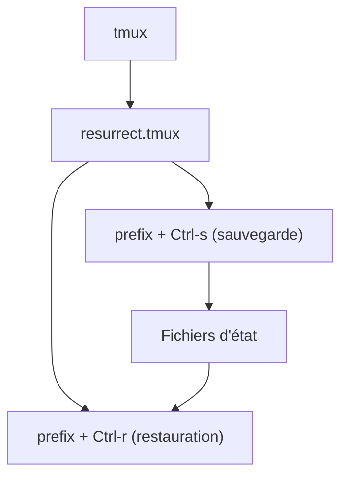

# tmux-plugins/tmux-resurrect

> Plugin tmux qui sauvegarde et restaure sessions, fenêtres et panneaux après un redémarrage, pour utilisateurs de tmux.

## Le problème
Redémarrer la machine fait perdre tous les programmes, répertoires et agencements de panneaux de tmux.

## Ce que ça fait vraiment
Sauvegarde sessions, fenêtres, panneaux, répertoires courants, agencements exacts et programmes en cours. Restaure aussi, en option, les sessions vim/neovim et le contenu des panneaux. Idempotent : ne recrée pas ce qui existe. Seule une liste prudente de programmes est relancée (vi, vim, htop, man, tail...).

## Comment c'est branché
Schéma simplifié d'après la fiche, sans diagramme fourni.



## Essayer
```bash
set -g @plugin 'tmux-plugins/tmux-resurrect'
git clone https://github.com/tmux-plugins/tmux-resurrect ~/clone/path
run-shell ~/clone/path/resurrect.tmux
tmux source-file ~/.tmux.conf
```
La première ligne va dans `.tmux.conf` (TPM, puis `prefix + I`) ; les suivantes forment l'installation manuelle.

## Coût et pièges
Gratuit. Demande tmux 1.9 ou plus et bash. Dernier push août 2024 ; 310 issues ouvertes.

## Ce que ce n'est pas
Ce n'est pas une sauvegarde automatique : il faut déclencher la sauvegarde (ou ajouter tmux-continuum). Il ne restaure pas l'état interne des programmes arbitraires.

## Alternatives
- tmux-continuum : sauvegarde et restauration automatiques et continues.

## Pour toi
À adopter si tu travailles sur des serveurs GPU ou des sessions longues en tmux : retrouver ses panneaux après un redémarrage évite de perdre le contexte. Maintenance ralentie, mais le périmètre est stable.

