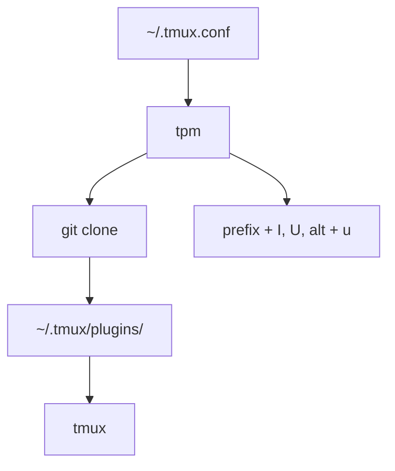

# tmux-plugins/tpm

> Plugin manager for tmux: installs, updates and loads plugins from git.

## The problem
Installing and keeping tmux plugins up to date by hand, one git repository after another, is tedious.

## What it actually does
Reads the list of `set -g @plugin '...'` lines in `~/.tmux.conf`, clones each plugin into `~/.tmux/plugins/` and loads it. Shortcuts: `prefix` + I to install, `prefix` + U to update, `prefix` + alt + u to remove. Works on Linux, OSX and Cygwin.

## How it is wired
Simplified diagram based on the sheet, no diagram provided.


## Trying it
```bash
git clone https://github.com/tmux-plugins/tpm ~/.tmux/plugins/tpm
tmux source ~/.tmux.conf
```
Then add `run '~/.tmux/plugins/tpm/tpm'` at the bottom of `~/.tmux.conf`.

## Cost and gotchas
Free. Requires tmux 1.9 or later, git and bash. The `run` line must stay at the very bottom of the configuration file.

## What it is not
It is not a plugin itself: it only manages the ones you list. Local tests require vagrant.

## Alternatives
- tpack: direct replacement with a TUI interface, automatic updates and a plugin browser.

## For you
Adopt: if you work in remote terminals (GPU servers, SSH), tmux and its plugins can be managed in five lines.
