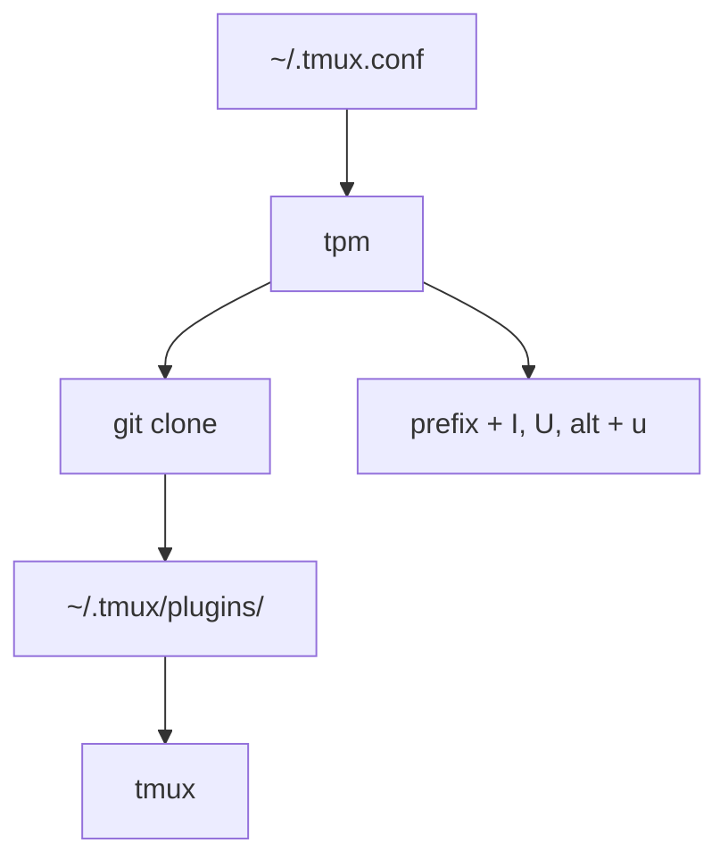

# tmux-plugins/tpm

> Gestionnaire de plugins pour tmux : installe, met à jour et charge les plugins depuis git.

## Le problème
Installer et tenir à jour des plugins tmux à la main, un dépôt git après l'autre, est fastidieux.

## Ce que ça fait vraiment
Lit la liste `set -g @plugin '...'` du fichier `~/.tmux.conf`, clone chaque plugin dans `~/.tmux/plugins/` et le charge. Raccourcis : `prefix` + I pour installer, `prefix` + U pour mettre à jour, `prefix` + alt + u pour supprimer. Fonctionne sur Linux, OSX et Cygwin.

## Comment c'est branché
Schéma simplifié d'après la fiche, sans diagramme fourni.


## Essayer
```bash
git clone https://github.com/tmux-plugins/tpm ~/.tmux/plugins/tpm
tmux source ~/.tmux.conf
```
Puis ajouter `run '~/.tmux/plugins/tpm/tpm'` en bas de `~/.tmux.conf`.

## Coût et pièges
Gratuit. Nécessite tmux 1.9 ou plus, git et bash. La ligne `run` doit rester tout en bas du fichier de configuration.

## Ce que ce n'est pas
Ce n'est pas un plugin en soi : il ne gère que ceux que tu listes. Les tests locaux demandent vagrant.

## Alternatives
- tpack : remplaçant direct avec interface TUI, mises à jour automatiques et navigateur de plugins.

## Pour toi
À adopter : si tu travailles dans des terminaux distants (serveurs GPU, SSH), tmux et ses plugins se gèrent en cinq lignes.

