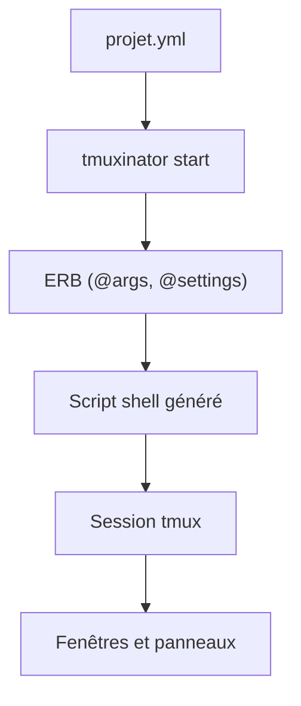

# tmuxinator/tmuxinator

> Tool for creating and restarting complete tmux sessions from a YAML file, for people who juggle between projects.

## The problem
Rebuilding tmux windows, panes and commands by hand for every project is slow and repetitive.

## What it actually does
A YAML file describes the name, the root, the windows, the panes, the layout and the commands (sent via send-keys, so they work over SSH). It handles project hooks, `pre_window`, interpreter managers, arguments via ERB, start, stop, copy, a diagnostic (`doctor`) and an `--append` mode.

## How it is wired


## Trying it
```bash
gem install tmuxinator
tmuxinator new [project]
tmuxinator start [project]
tmuxinator stop [project]
tmuxinator doctor
```

## Cost and gotchas
Free. You need Ruby (a maintained version, via RVM or rbenv if the system one is too old) and tmux 1.8 or later, except 2.5. Project names must not contain a dot. Commands may be lost if the terminal buffer is full.

## What it is not
Not a process manager or an orchestrator: it only prepares tmux sessions.

## Alternatives
- No alternative named in the README.

## For you
Worth watching: handy if you launch the same set of terminals every day (training, logs, notebook); otherwise a simple tmux script is enough.
