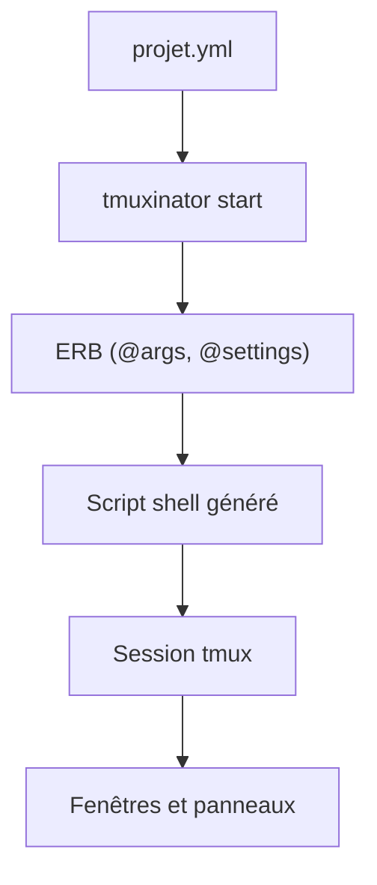

# tmuxinator/tmuxinator

> Outil pour créer et relancer des sessions tmux complètes à partir d'un fichier YAML, pour qui jongle entre projets.

## Le problème
Remonter à la main fenêtres, panneaux et commandes tmux à chaque projet est long et répétitif.

## Ce que ça fait vraiment
Un fichier YAML décrit le nom, la racine, les fenêtres, les panneaux, la disposition et les commandes (envoyées via send-keys, donc exécutables sur SSH). Il gère des hooks de projet, `pre_window`, des gestionnaires d'interpréteurs, des arguments via ERB, le démarrage, l'arrêt, la copie, un diagnostic (`doctor`) et un mode `--append`.

## Comment c'est branché


## Essayer
```bash
gem install tmuxinator
tmuxinator new [project]
tmuxinator start [project]
tmuxinator stop [project]
tmuxinator doctor
```

## Coût et pièges
Gratuit. Il faut Ruby (une version maintenue, via RVM ou rbenv si celui du système est trop ancien) et tmux 1.8 ou plus, hors 2.5. Les noms de projet ne doivent pas contenir de point. Des commandes peuvent être perdues si le tampon du terminal est plein.

## Ce que ce n'est pas
Pas un gestionnaire de processus ni un orchestrateur : il ne fait que préparer des sessions tmux.

## Alternatives
- Aucune alternative nommée dans le README.

## Pour toi
À surveiller : pratique si tu lances chaque jour le même ensemble de terminaux (entraînement, logs, notebook) ; sinon un simple script tmux suffit.

