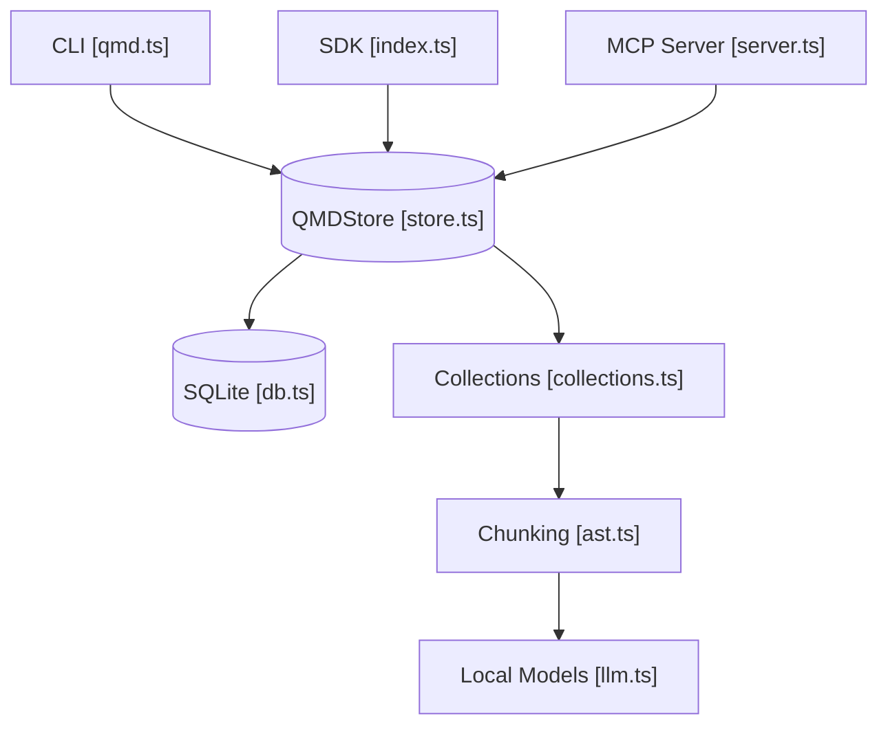

# tobi/qmd

> Local search engine over Markdown notes and documents, combining BM25, vectors and LLM reranking.

## The problem
Finding a passage in notes, transcripts or docs, for a human or an agent, without sending your data to a third-party service.

## What it actually does
Indexes collections of files into a single SQLite database (FTS5 and sqlite-vec). `qmd query` expands the query, merges BM25 and vectors via RRF, then reranks. Three local GGUF models (embedding, reranker, expansion) run through node-llama-cpp. Available as a CLI, a Node/Bun SDK and an MCP server (stdio or HTTP).

## How it is wired


## Trying it
```bash
npm install -g @tobilu/qmd
qmd collection add ~/notes --name notes
qmd context add qmd://notes "Personal notes and ideas"
qmd embed
qmd search "project timeline"
qmd query "quarterly planning process"
qmd mcp --http
```

## Cost and gotchas
Free. About 2 GB of models downloaded on first use and VRAM used; the HTTP server has no authentication. Changing the embedding model requires `qmd embed -f`.

## What it is not
Not a managed service. embeddinggemma is English-oriented; CJK requires another model. README truncated at the end of the document.

## Alternatives
None named in the README.

## For you
Adopt: hybrid local search with MCP, directly useful to give your agents context from your own notes.
