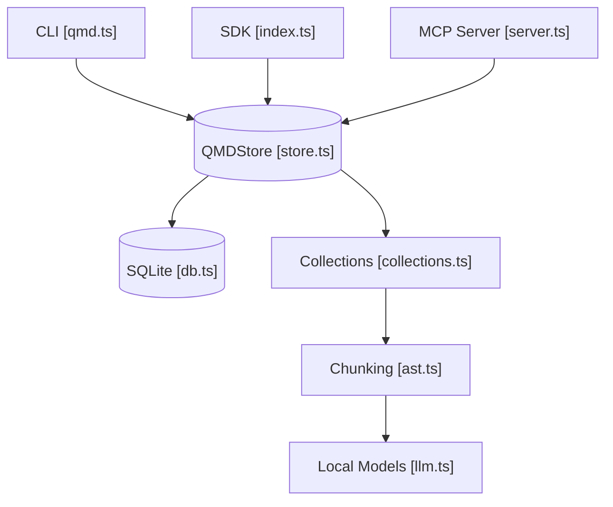

# tobi/qmd

> Moteur de recherche local sur notes et documents Markdown, mêlant BM25, vecteurs et reranking par LLM.

## Le problème
Retrouver un passage dans des notes, transcriptions ou docs, pour un humain ou un agent, sans envoyer ses données à un service tiers.

## Ce que ça fait vraiment
Indexe des collections de fichiers dans un SQLite unique (FTS5 et sqlite-vec). `qmd query` élargit la requête, fusionne BM25 et vecteurs par RRF puis rerank. Trois modèles GGUF locaux (embedding, reranker, expansion) s'exécutent via node-llama-cpp. Disponible en CLI, SDK Node/Bun et serveur MCP (stdio ou HTTP).

## Comment c'est branché


## Essayer
```bash
npm install -g @tobilu/qmd
qmd collection add ~/notes --name notes
qmd context add qmd://notes "Personal notes and ideas"
qmd embed
qmd search "project timeline"
qmd query "quarterly planning process"
qmd mcp --http
```

## Coût et pièges
Gratuit. Téléchargement d'environ 2 Go de modèles au premier usage et VRAM utilisée ; le serveur HTTP n'a pas d'authentification. Changer de modèle d'embedding impose `qmd embed -f`.

## Ce que ce n'est pas
Pas un service géré. embeddinggemma est orienté anglais ; le CJC exige un autre modèle. README tronqué en fin de document.

## Alternatives
Aucune nommée dans le README.

## Pour toi
À adopter : recherche locale hybride avec MCP, directement utile pour donner du contexte à tes agents sur tes propres notes.

