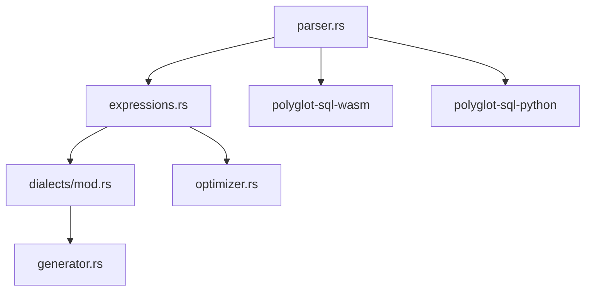

# tobilg/polyglot

> SQL transpiler in Rust, inspired by sqlglot, for more than 30 dialects, with Python, TypeScript and Go bindings.

## The problem
Rewriting a query from one SQL dialect to another, or analyzing it programmatically, requires a reliable parser.

## What it actually does
Parsing, generation, transpilation and formatting of SQL, with a typed AST and a query builder. Syntactic and semantic validation against a schema, column lineage and OpenLineage-compatible payloads, compact query analysis. The Rust core is exposed as a crate, WASM, a PyPI package (PyO3), C FFI and a Go SDK. The README claims a 100% pass rate on 11,333 cases taken from SQLGlot.

## How it is wired


## Trying it
```bash
pip install polyglot-sql
npm install @polyglot-sql/sdk
cargo build -p polyglot-sql
```

## Cost and gotchas
Free, no external service. The Go SDK needs a separate FFI library. The WASI module is experimental.

## What it is not
Not a SQL execution engine: it manipulates text and trees. Lineage covers one query at a time, not impact across queries.

## Alternatives
- sqlglot: the original in Python, which this project draws inspiration from (compared in the benchmarks).

## For you
Adopt on a trial basis: dialect migration, lineage and query analysis directly serve a data profile, with an installable pip package.
