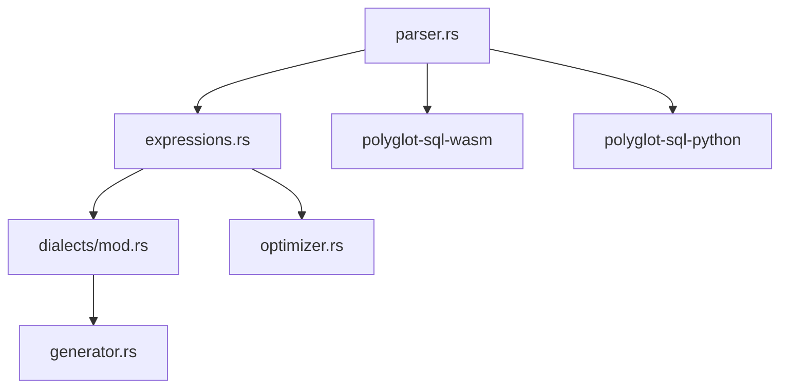

# tobilg/polyglot

> Transpileur SQL en Rust, inspiré de sqlglot, pour plus de 30 dialectes, avec liaisons Python, TypeScript et Go.

## Le problème
Réécrire une requête d'un dialecte SQL à l'autre, ou l'analyser par programme, demande un parseur fiable.

## Ce que ça fait vraiment
Analyse, génération, transpilation et mise en forme du SQL, avec un AST typé et un constructeur de requêtes. Validation syntaxique et sémantique selon un schéma, lignage de colonnes et charges compatibles OpenLineage, analyse compacte des requêtes. Le cœur Rust est exposé en crate, WASM, paquet PyPI (PyO3), FFI C et SDK Go. Le README annonce 100 % de réussite sur 11 333 cas issus de SQLGlot.

## Comment c'est branché


## Essayer
```bash
pip install polyglot-sql
npm install @polyglot-sql/sdk
cargo build -p polyglot-sql
```

## Coût et pièges
Gratuit, sans service externe. Le SDK Go demande une bibliothèque FFI séparée. Le module WASI est expérimental.

## Ce que ce n'est pas
Pas un moteur d'exécution SQL : il manipule du texte et des arbres. Le lignage couvre une requête à la fois, pas l'impact entre requêtes.

## Alternatives
- sqlglot : l'original en Python, dont ce projet s'inspire (comparé dans les benchmarks).

## Pour toi
Adopter à l'essai : migration de dialectes, lignage et analyse de requêtes servent directement un profil data, avec un paquet pip installable.

