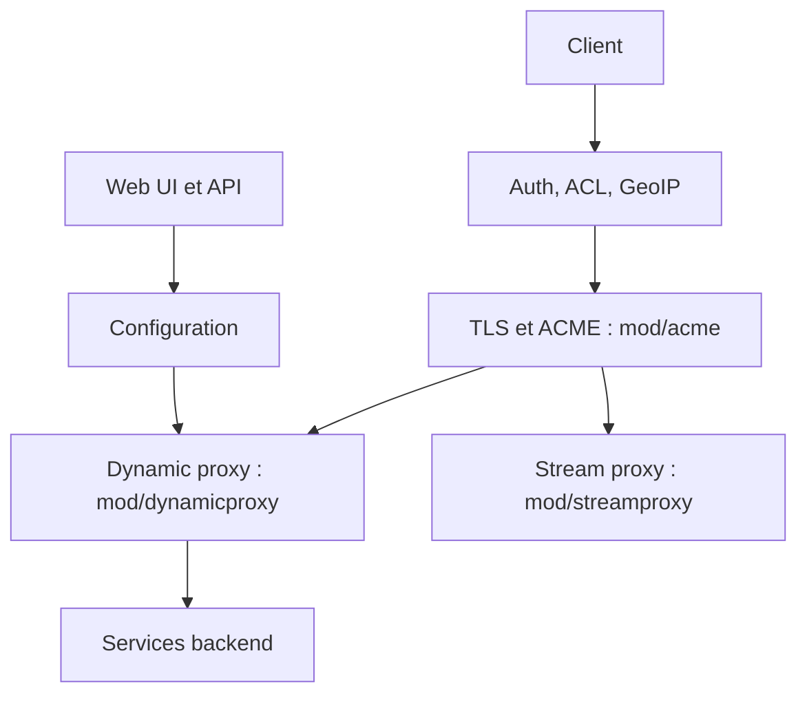

# tobychui/zoraxy

> HTTP reverse proxy in Go with a web interface, automatic certificates and network tools for homelabs.

## The problem
Publishing several internal services over HTTPS means manually configuring a proxy, certificates and access rules.

## What it actually does
Zoraxy does HTTP/2 reverse proxying, WebSocket proxying, TCP/UDP, virtual hosts and load balancing. It handles TLS and ACME (automatic renewal, DNS challenge), blacklists or whitelists by country or IP, and uptime monitoring. It also includes a web SSH terminal, a port and IP scanner, Wake-on-LAN and a plugin system.

## How it is wired


## Trying it
```bash
git clone https://github.com/tobychui/zoraxy
cd ./zoraxy/src/
go mod tidy
go build
sudo ./zoraxy -port=:8000
```

## Cost and gotchas
Free. Go 1.23 or later to build; binaries exist. AGPL-3.0 license (network copyleft). The `-noauth` mode disables authentication and the web SSH feature carries a documented danger. Security reports go through Discord.

## What it is not
Not a full application firewall: the README is still looking for a maintainer for logging and attack prevention.

## Alternatives
None named; the README only offers an experimental converter from Nginx.

## For you
Worth watching: useful for exposing your self-hosted MLOps tools over HTTPS, but a single person carries it and the AGPL weighs.
