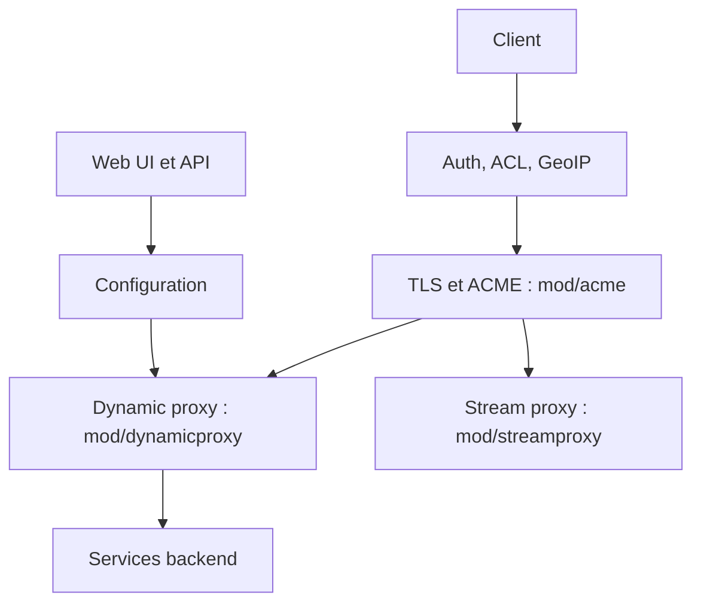

# tobychui/zoraxy

> Reverse proxy HTTP en Go avec interface web, certificats automatiques et outils réseau pour homelab.

## Le problème
Publier plusieurs services internes en HTTPS demande de configurer à la main un proxy, des certificats et des règles d'accès.

## Ce que ça fait vraiment
Zoraxy fait du reverse proxy HTTP/2, du proxy WebSocket, TCP/UDP, des hôtes virtuels et de l'équilibrage de charge. Il gère TLS et ACME (renouvellement automatique, défi DNS), des listes noires ou blanches par pays ou IP, et la surveillance de disponibilité. S'y ajoutent un terminal SSH web, un scanner de ports et d'IP, Wake-on-LAN et un système de plugins.

## Comment c'est branché


## Essayer
```bash
git clone https://github.com/tobychui/zoraxy
cd ./zoraxy/src/
go mod tidy
go build
sudo ./zoraxy -port=:8000
```

## Coût et pièges
Gratuit. Go 1.23 ou plus pour compiler ; des binaires existent. Licence AGPL-3.0 (copyleft réseau). Le mode `-noauth` désactive l'authentification et la fonction SSH web contient un danger documenté. Les rapports de sécurité passent par Discord.

## Ce que ce n'est pas
Ce n'est pas un pare-feu applicatif complet : le README cherche encore un mainteneur pour la journalisation et la prévention d'attaques.

## Alternatives
Aucune alternative nommée ; le README propose seulement un convertisseur expérimental depuis Nginx.

## Pour toi
À surveiller : utile pour exposer tes outils MLOps auto-hébergés en HTTPS, mais une seule personne le porte et l'AGPL pèse.

