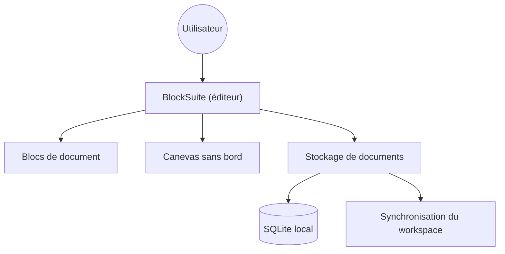

# toeverything/AFFiNE

> Local-first workspace that merges documents, whiteboard and databases, an alternative to Notion and Miro.

## The problem
Notes, diagrams and tables are scattered across several SaaS tools, with data held by the vendor.

## What it actually does
Block editor (BlockSuite) with a document view and an edgeless canvas, multi-view databases, imports and exports. Data is stored locally (SQLite) and synced in real time, with a multimodal AI partner. Self-hosting goes through Docker.

## How it is wired

## Trying it
No command documented in the README: self-hosting and building refer to the documentation and to `BUILDING.md`.

## Cost and gotchas
The Community edition is free when self-hosted; the Enterprise edition (SSO, audit) is paid. AI features rely on the vendor's service. License flagged "to verify" by GitHub.

## What it is not
Not a data or notebook tool: it is a note-taking and whiteboard tool. The Enterprise edition is not yet released.

## Alternatives
No alternative named in the README, apart from Notion and Miro, of which it aims to be the alternative.

## For you
Worth watching: useful for local notes and architecture diagrams, but the license needs clarifying before any professional use.
