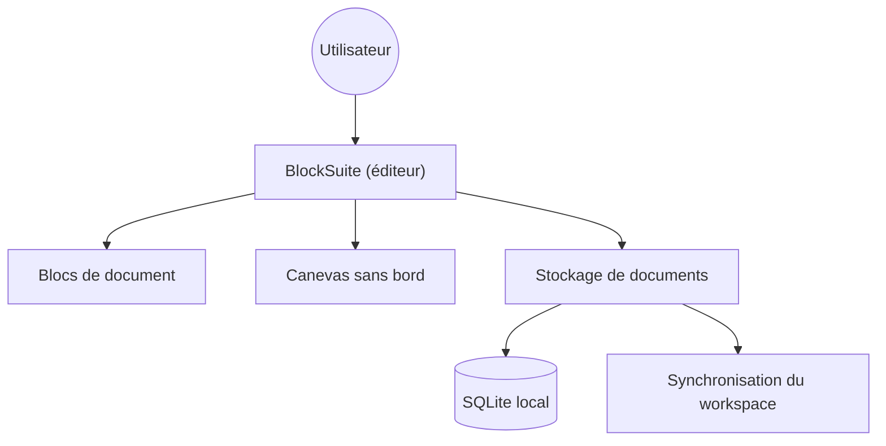

# toeverything/AFFiNE

> Espace de travail local-first qui fusionne documents, tableau blanc et bases de données, alternative à Notion et Miro.

## Le problème
Notes, schémas et tableaux sont éclatés entre plusieurs outils SaaS, avec des données chez l'éditeur.

## Ce que ça fait vraiment
Éditeur à blocs (BlockSuite) avec vue document et canevas sans bord, bases de données multi-vues, imports et exports. Les données sont stockées localement (SQLite) et synchronisées en temps réel, avec un partenaire IA multimodal. L'auto-hébergement passe par Docker.

## Comment c'est branché

## Essayer
Aucune commande documentée dans le README : l'auto-hébergement et la compilation renvoient à la documentation et à `BUILDING.md`.

## Coût et pièges
L'édition Community est gratuite en auto-hébergement ; l'édition Entreprise (SSO, audit) est payante. Les fonctions IA relèvent du service de l'éditeur. Licence signalée « à vérifier » par GitHub.

## Ce que ce n'est pas
Pas un outil de données ni de notebooks : c'est un outil de prise de notes et de whiteboard. L'édition Entreprise n'est pas encore publiée.

## Alternatives
Aucune alternative nommée dans le README, hormis Notion et Miro dont il se veut l'alternative.

## Pour toi
À surveiller : utile pour des notes locales et des schémas d'architecture, mais la licence est à clarifier avant tout usage pro.

