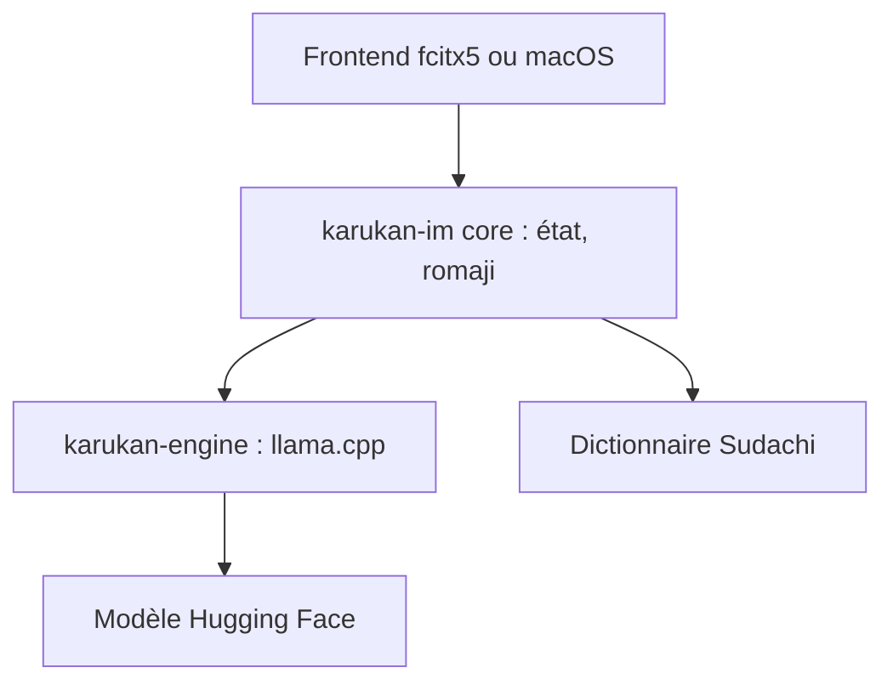

# togatoga/karukan

> Japanese input method with neural kana-kanji conversion, for Linux (fcitx5) and macOS.

## The problem
Classic Japanese input methods handle the context around the typed text poorly.

## What it actually does
Karukan converts kana to kanji with a GPT-2 or Qwen3 type model run by llama.cpp. It offers live conversion, context awareness, learning of choices, the Sudachi dictionary, candidates ported from Mozc, emoji and kanji-by-kanji conversion.

## How it is wired

## Trying it
No command documented in the README: installation points to the READMEs of karukan-fcitx5 and karukan-macos.

## Cost and gotchas
Free. The model is downloaded from Hugging Face on first launch; typing and the dictionary work in the meantime. Rust toolchain to compile (not documented here). The README is in Japanese.

## What it is not
Not a complete desktop application: it is only an input engine. No Windows version mentioned.

## Alternatives
- Mozc: source of the ported candidate rules.

## For you
Ignore unless you type in Japanese: the idea of a small local model for input is instructive, but the use remains niche.
