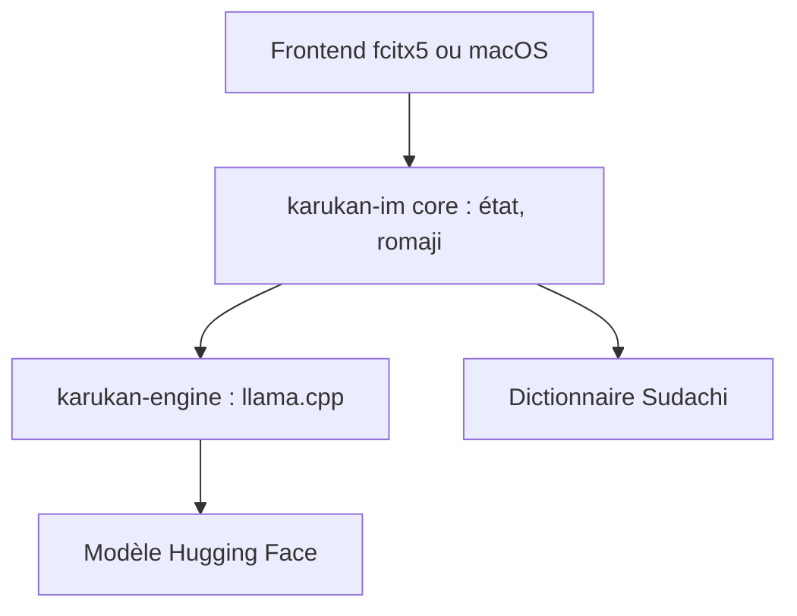

# togatoga/karukan

> Méthode de saisie japonaise à conversion kana-kanji neuronale, pour Linux (fcitx5) et macOS.

## Le problème
Les méthodes de saisie japonaises classiques gèrent mal le contexte autour du texte saisi.

## Ce que ça fait vraiment
Karukan convertit le kana en kanji avec un modèle de type GPT-2 ou Qwen3 exécuté par llama.cpp. Il propose conversion en direct, prise en compte du contexte, apprentissage des choix, dictionnaire Sudachi, candidats portés de Mozc, emoji et conversion kanji par kanji.

## Comment c'est branché

## Essayer
Aucune commande documentée dans le README : l'installation renvoie aux README de karukan-fcitx5 et karukan-macos.

## Coût et pièges
Gratuit. Le modèle se télécharge depuis Hugging Face au premier lancement ; la saisie et le dictionnaire fonctionnent en attendant. Chaîne Rust à compiler (non documenté ici). Le README est en japonais.

## Ce que ce n'est pas
Pas une application de bureau complète : ce n'est qu'un moteur de saisie. Pas de version Windows mentionnée.

## Alternatives
- Mozc : source des règles de candidats portées.

## Pour toi
À ignorer sauf si tu tapes en japonais : l'idée d'un petit modèle local pour la saisie est instructive, mais l'usage reste de niche.

