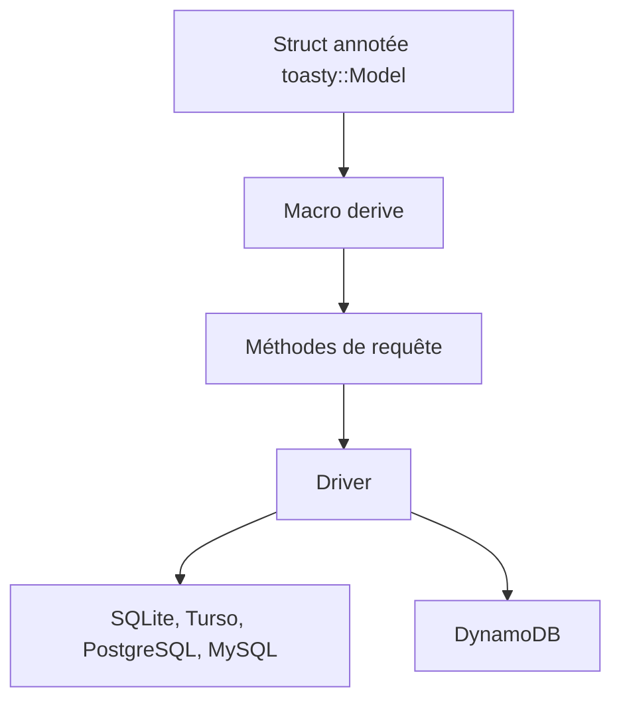

# tokio-rs/toasty

> Rust ORM for SQLite, PostgreSQL, MySQL and DynamoDB, aimed at Rust application developers.

## The problem
Writing SQL or DynamoDB queries by hand in Rust is repetitive, and a classic ORM hides the capabilities specific to each database.

## What it actually does
You declare your models with `#[derive(toasty::Model)]` and attributes (`#[key]`, `#[unique]`, `#[has_many]`). Toasty generates query methods only for indexed accesses. With SQL it allows extra constraints; with DynamoDB, only those the database can execute.

## How it is wired
Simplified diagram based on the sheet, no diagram provided.


## Trying it
```bash
# Le README ne donne pas de commande d'installation.
# Il renvoie au dossier examples/ et au crate toasty sur crates.io.
```

## Cost and gotchas
Free, MIT. No key or service; DynamoDB assumes an AWS account if you target it. The stability level is not documented.

## What it is not
Not an abstraction that hides the database: the README says it refuses to abstract the engine. Not a migration tool documented in this README.

## Alternatives
No alternative named in the README.

## For you
Ignore: a Rust ORM does not serve a data / AI / MLOps profile, unless you build a Rust service on DynamoDB or Postgres.
