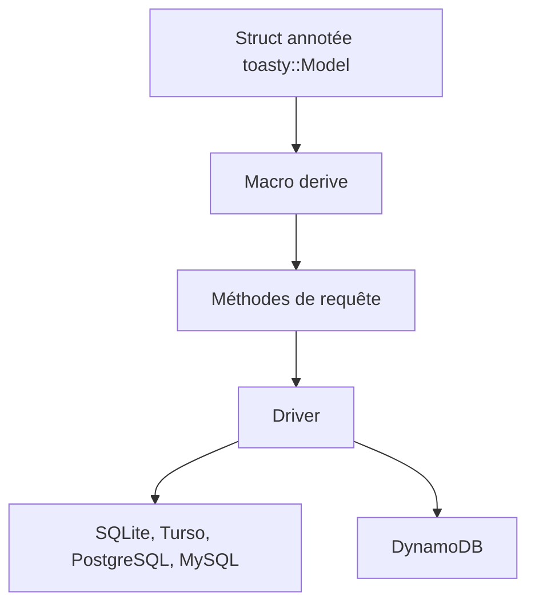

# tokio-rs/toasty

> ORM Rust pour SQLite, PostgreSQL, MySQL et DynamoDB, destiné aux développeurs d'applications Rust.

## Le problème
Écrire des requêtes SQL ou DynamoDB à la main en Rust est répétitif, et un ORM classique cache les capacités propres à chaque base.

## Ce que ça fait vraiment
Tu déclares tes modèles avec `#[derive(toasty::Model)]` et des attributs (`#[key]`, `#[unique]`, `#[has_many]`). Toasty génère des méthodes de requête seulement pour les accès indexés. Avec SQL il autorise des contraintes en plus ; avec DynamoDB, seulement celles que la base peut exécuter.

## Comment c'est branché
Schéma simplifié d'après la fiche, sans diagramme fourni.


## Essayer
```bash
# Le README ne donne pas de commande d'installation.
# Il renvoie au dossier examples/ et au crate toasty sur crates.io.
```

## Coût et pièges
Gratuit, MIT. Aucune clé ni service ; DynamoDB suppose un compte AWS si tu le cibles. Le niveau de stabilité n'est pas documenté.

## Ce que ce n'est pas
Pas une abstraction qui masque la base : le README dit refuser d'abstraire le moteur. Pas un outil de migration documenté dans ce README.

## Alternatives
Aucune alternative nommée dans le README.

## Pour toi
À ignorer : un ORM Rust ne sert pas un profil data / IA / MLOps, sauf si tu bâtis un service Rust sur DynamoDB ou Postgres.

