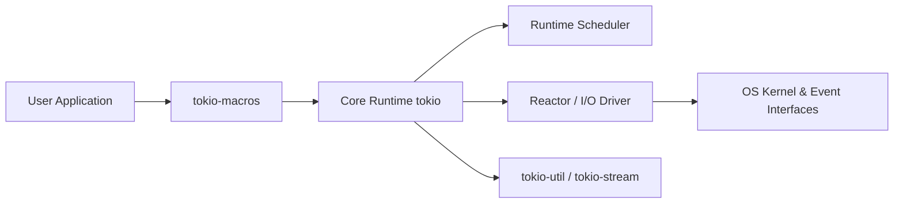

# tokio-rs/tokio

> Rust async runtime (scheduler, I/O reactor, sockets) for those writing network services in Rust.

## The problem
Rust does not ship an async runtime: without one, it is impossible to run futures or do non-blocking I/O at scale.

## What it actually does
Provides a multi-threaded work-stealing scheduler, a reactor backed by epoll/kqueue/IOCP, asynchronous TCP/UDP sockets, plus files, processes, signals, timers and synchronization primitives. The `#[tokio::main]` and `#[tokio::test]` macros generate the entry point. Features are enabled through feature flags. One minor release per month, with LTS versions.

## How it is wired


## Trying it
```bash
# Cargo.toml
# tokio = { version = "1.54.1", features = ["full"] }
```
Then the README's TCP echo server (`TcpListener::bind("127.0.0.1:8080")`) in `main.rs`.

## Cost and gotchas
Free. A Rust toolchain is required; the `full` feature flag compiles far more than necessary. An LTS release is advisable if you want to pin a minor version (`~1.51`).

## What it is not
Neither a web framework (see axum, hyper, tonic) nor a solution for CPU-parallel computation. The code stays in Rust: no direct use from Python.

## Alternatives
- mio: low-level I/O layer under tokio, if you want to drive everything yourself.
- axum / hyper / tonic: for a ready-to-use HTTP or gRPC service.

## For you
Ignore on the data/AI side as long as you are not writing a Rust service: it is an infrastructure building block that you will only meet as a dependency of Rust tools.
