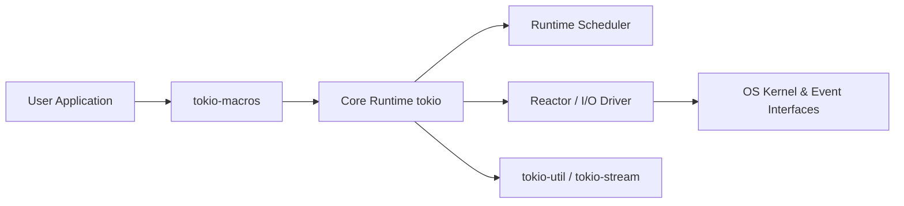

# tokio-rs/tokio

> Runtime asynchrone Rust (scheduler, réacteur d'E/S, sockets) pour qui écrit des services réseau en Rust.

## Le problème
Rust n'embarque pas de runtime async : sans lui, impossible d'exécuter des futures ni de faire des E/S non bloquantes à l'échelle.

## Ce que ça fait vraiment
Fournit un scheduler multi-thread à vol de tâches, un réacteur adossé à epoll/kqueue/IOCP, des sockets TCP/UDP asynchrones, plus fichiers, processus, signaux, timers et primitives de synchronisation. Les macros `#[tokio::main]` et `#[tokio::test]` génèrent le point d'entrée. Les fonctionnalités s'activent par feature flags. Une version mineure par mois, avec des versions LTS.

## Comment c'est branché


## Essayer
```bash
# Cargo.toml
# tokio = { version = "1.54.1", features = ["full"] }
```
Puis le serveur d'écho TCP du README (`TcpListener::bind("127.0.0.1:8080")`) dans `main.rs`.

## Coût et pièges
Gratuit. Il faut une chaîne Rust ; le feature flag `full` compile beaucoup plus que nécessaire. Version LTS conseillée si l'on veut figer une mineure (`~1.51`).

## Ce que ce n'est pas
Ni un framework web (voir axum, hyper, tonic) ni une solution pour du calcul parallèle CPU. Le code reste en Rust : aucun usage direct depuis Python.

## Alternatives
- mio : couche d'E/S bas niveau sous tokio, si l'on veut tout piloter soi-même.
- axum / hyper / tonic : pour un service HTTP ou gRPC prêt à l'emploi.

## Pour toi
À ignorer côté data/IA tant que tu n'écris pas de service Rust : c'est une brique d'infrastructure, que tu ne rencontreras qu'en dépendance d'outils Rust.

