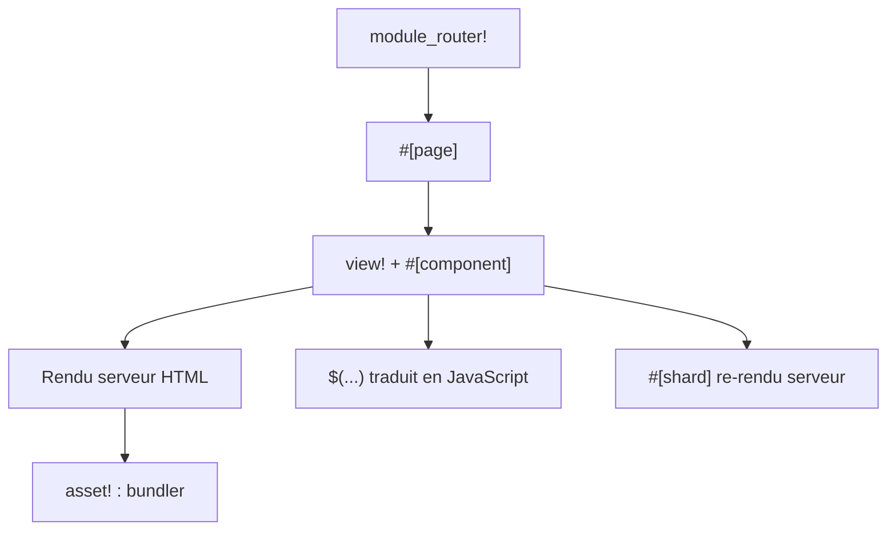

# tokio-rs/topcoat

> Modular full-stack Rust framework, with server-side rendering and client-side reactivity, for web applications.

## The problem
A Rust web application requires a separate API layer and a client bundle, which multiplies the glue code.

## What it actually does
Renders all HTML on the server with the `view!` macro; async components can query the database directly. `$(...)` expressions are typed Rust, evaluated on the server then translated into JavaScript, without wasm. The `#[shard]` component re-renders on the server. Routing comes from the module tree, with asset bundling, Topcoat UI components and mail.

## How it is wired
Simplified diagram based on the fiche, no diagram provided.


## Trying it
```bash
topcoat new
topcoat fmt
```

## Cost and gotchas
Free. Rust toolchain required (not listed among the prerequisites). The README warns: early and experimental stage, breaking changes expected.

## What it is not
Not a stable framework: the API may change. It does not target data computation.

## Alternatives
No alternative named in the README; it cites htmx, Alpine AJAX and Datastar as possible integrations.

## For you
Worth watching: interesting if you write web interfaces in Rust for internal tools, too young for production use.
