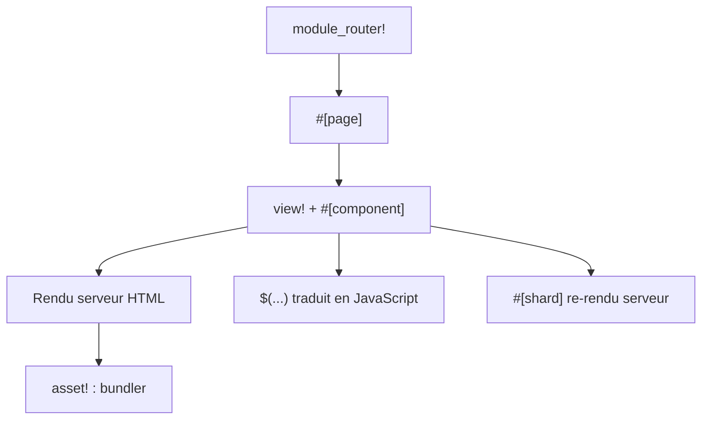

# tokio-rs/topcoat

> Framework Rust full-stack modulaire, avec rendu serveur et réactivité côté client, pour applications web.

## Le problème
Une application web Rust demande une couche d'API séparée et un bundle client, ce qui multiplie le code d'assemblage.

## Ce que ça fait vraiment
Rend tout le HTML côté serveur avec la macro `view!` ; les composants async peuvent interroger la base directement. Les expressions `$(...)` sont du Rust typé, évalué côté serveur puis traduit en JavaScript, sans wasm. Le composant `#[shard]` se re-rend côté serveur. Le routage vient de l'arborescence des modules, avec empaquetage des assets, composants Topcoat UI et courrier.

## Comment c'est branché
Schéma simplifié d'après la fiche, sans diagramme fourni.


## Essayer
```bash
topcoat new
topcoat fmt
```

## Coût et pièges
Gratuit. Toolchain Rust nécessaire (non listée parmi les prérequis). Le README prévient : stade précoce et expérimental, changements incompatibles attendus.

## Ce que ce n'est pas
Ce n'est pas un framework stable : l'API peut changer. Il ne cible pas le calcul de données.

## Alternatives
Aucune alternative nommée dans le README ; il cite htmx, Alpine AJAX et Datastar comme intégrations possibles.

## Pour toi
À surveiller : intéressant si tu écris des interfaces web en Rust pour des outils internes, trop jeune pour un usage de production.

