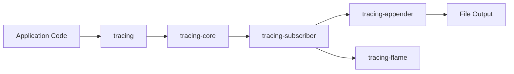

# tokio-rs/tracing

> Instrumentation framework for Rust programs that collects structured spans and events.

## The problem
Text logs lose context in asynchronous code; you need structured traces tied to spans.

## What it actually does
The `tracing` crate provides macros and types to emit events and spans, and `#[instrument]` to trace a function (including async ones). A `Subscriber` collects the data; `tracing-subscriber` provides default formatting and filtering. Companion crates: `tracing-appender`, `tracing-log`, `tracing-error`, `tracing-flame`, `tracing-journald`. Maintained by the Tokio project without requiring the tokio runtime.

## How it is wired


## Trying it
```bash
# Cargo.toml : tracing = "0.1" et tracing-subscriber = "0.3"
```
```rust
tracing_subscriber::fmt::init();
info!(number_of_yaks, "preparing to shave yaks");
```

## Cost and gotchas
Free. A library must not install a global subscriber; in an async future, use `#[instrument]` or `.instrument()`, not `span.enter()`. Several companion crates are unstable.

## What it is not
Not an observability backend: it emits, other tools store and display. Rust only. A `v0.2.x` branch is not yet released.

## Alternatives
No alternative named in the README (third-party integrations such as Sentry or Loki are listed there).

## For you
Ignore unless you write Rust services: essential then, irrelevant for Python data or ML.
