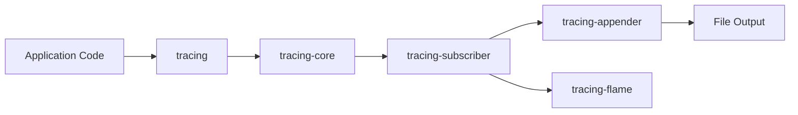

# tokio-rs/tracing

> Cadre d'instrumentation pour programmes Rust qui collecte des spans et événements structurés.

## Le problème
Les logs textuels perdent le contexte dans du code asynchrone ; il faut des traces structurées liées à des spans.

## Ce que ça fait vraiment
La crate `tracing` offre macros et types pour émettre événements et spans, `#[instrument]` pour tracer une fonction (y compris async). Un `Subscriber` collecte les données ; `tracing-subscriber` fournit un formatage et un filtrage par défaut. Des crates annexes : `tracing-appender`, `tracing-log`, `tracing-error`, `tracing-flame`, `tracing-journald`. Maintenu par le projet Tokio sans exiger le runtime tokio.

## Comment c'est branché


## Essayer
```bash
# Cargo.toml : tracing = "0.1" et tracing-subscriber = "0.3"
```
```rust
tracing_subscriber::fmt::init();
info!(number_of_yaks, "preparing to shave yaks");
```

## Coût et pièges
Gratuit. Une bibliothèque ne doit pas installer de subscriber global ; dans une future async, utiliser `#[instrument]` ou `.instrument()`, pas `span.enter()`. Plusieurs crates annexes sont instables.

## Ce que ce n'est pas
Pas un backend d'observabilité : il émet, d'autres outils stockent et affichent. Rust seulement. Une branche `v0.2.x` n'est pas encore publiée.

## Alternatives
Aucune alternative nommée dans le README (les intégrations tierces comme Sentry ou Loki y sont listées).

## Pour toi
À ignorer sauf si tu écris des services en Rust : indispensable alors, hors sujet pour du Python data ou ML.

