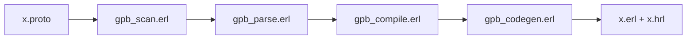

# tomas-abrahamsson/gpb

> Compilateur Erlang de définitions Google Protocol Buffers, générant code d'encodage et de décodage.

## Le problème
Utiliser des messages protobuf depuis Erlang sans passer par le compilateur de Google.

## Ce que ça fait vraiment
`protoc-erl` lit un `.proto` et génère un module `.erl` et un `.hrl` (records ou maps) avec encodage/décodage. Gère messages imbriqués, oneof, map, proto3, extensions, groupes, correspondance JSON. Fonctions d'introspection générées. Ne gère pas rpc ni les options personnalisées agrégées. Mauvais rapport d'erreurs sur les `.proto` invalides.

## Comment c'est branché


## Essayer
```bash
.../gpb/bin/protoc-erl -I. x.proto
erlc -I.../gpb/include x.erl
```
```erlang
x:encode_msg(#'Person'{name="abc def", id=345, email="a@example.com"}).
```

## Coût et pièges
Gratuit. Version fixée par tag git : compilation hors dépôt git demande `gpb.vsn`. Changements incompatibles en 4.0.0 et 5.0.0.

## Ce que ce n'est pas
Pas une bibliothèque gRPC complète ; le README renvoie à grpcbox et grpc. Licence non identifiée par GitHub.

## Alternatives
Le README cite exprotobuf (Elixir), enif_protobuf (NIF) et rebar3_gpb_plugin.

## Pour toi
À ignorer : outil Erlang spécialisé, hors stack data/IA.

