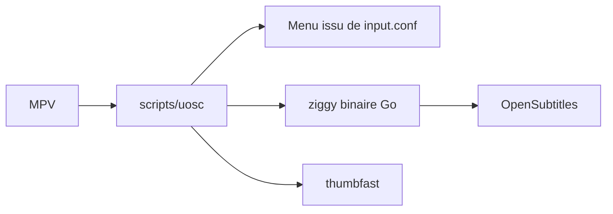

# tomasklaen/uosc

> Minimalist proximity-based interface for the MPV video player, for MPV users.

## The problem
MPV's native interface is very bare: no configurable context menus, nor comfortable track or subtitle selection.

## What it actually does
MPV script that displays the timeline, volume, speed and a control bar depending on cursor proximity. Context menu built from `input.conf` via `#!` comments. Track selection, Open Subtitles download (5 per day without authentication), playlist, thumbnails via thumbfast. A Go binary, ziggy, handles subtitle search and clipboard.

## How it is wired


## Trying it
```bash
/bin/bash -c "$(curl -fsSL https://raw.githubusercontent.com/tomasklaen/uosc/HEAD/installers/unix.sh)"
tools/build ziggy
```

## Cost and gotchas
Free. Requires mpv 0.33 or later. The Go binary is sometimes flagged by antivirus software (false positives explained in the FAQ). Built-in update is broken under snap and macOS.

## What it is not
Not a video player: it only works with MPV. Outside the data/AI profile.

## Alternatives
The README cites thumbfast as a complement, not as an alternative.

## For you
Ignore for your profile: a comfort utility for a video player, unrelated to data, AI or MLOps, well made but off-topic.
