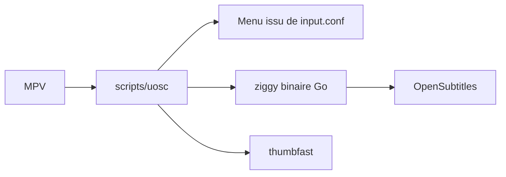

# tomasklaen/uosc

> Interface minimaliste à apparition par proximité du curseur pour le lecteur vidéo MPV, pour utilisateurs MPV.

## Le problème
L'interface native de MPV est très dépouillée : pas de menus contextuels configurables, ni sélection de pistes ou de sous-titres confortable.

## Ce que ça fait vraiment
Script MPV qui affiche timeline, volume, vitesse et barre de contrôle selon la proximité du curseur. Menu contextuel construit depuis `input.conf` via des commentaires `#!`. Sélection de pistes, téléchargement de sous-titres Open Subtitles (5 par jour sans authentification), playlist, miniatures via thumbfast. Un binaire Go, ziggy, gère recherche de sous-titres et presse-papiers.

## Comment c'est branché


## Essayer
```bash
/bin/bash -c "$(curl -fsSL https://raw.githubusercontent.com/tomasklaen/uosc/HEAD/installers/unix.sh)"
tools/build ziggy
```

## Coût et pièges
Gratuit. Requiert mpv 0.33 ou plus. Le binaire Go est parfois signalé par des antivirus (faux positifs expliqués dans la FAQ). Mise à jour intégrée cassée sous snap et macOS.

## Ce que ce n'est pas
Pas un lecteur vidéo : il ne fonctionne qu'avec MPV. Hors profil data/IA.

## Alternatives
Le README cite thumbfast comme complément, pas comme alternative.

## Pour toi
À ignorer pour ton profil : utilitaire de confort pour lecteur vidéo, sans lien avec data, IA ou MLOps, bien fait mais hors sujet.

