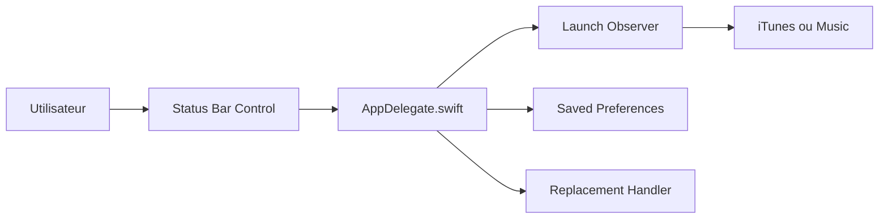

# tombonez/noTunes

> Small macOS application that prevents iTunes or Apple Music from launching.

## The problem
On macOS, iTunes or Music launches by itself, for example when a Bluetooth headset reconnects.

## What it actually does
Menu bar application: at startup it terminates running instances of iTunes/Music and watches for later launches. A left click on the icon turns blocking on or off. A `replacement` setting launches another application or a URL via `open` instead.

## How it is wired


## Trying it
```bash
brew install --cask notunes
defaults write digital.twisted.noTunes replacement /Applications/YOUR_MUSIC_APP.app
defaults delete digital.twisted.noTunes replacement
```

## Cost and gotchas
Free. macOS only. To show the hidden icon again: `defaults delete digital.twisted.noTunes` then relaunch. Last push in August 2024.

## What it is not
Not a player or a music manager: it only blocks a launch.

## Alternatives
No alternative named in the README.

## For you
Ignore: a convenience macOS utility, unrelated to data, AI or MLOps.
