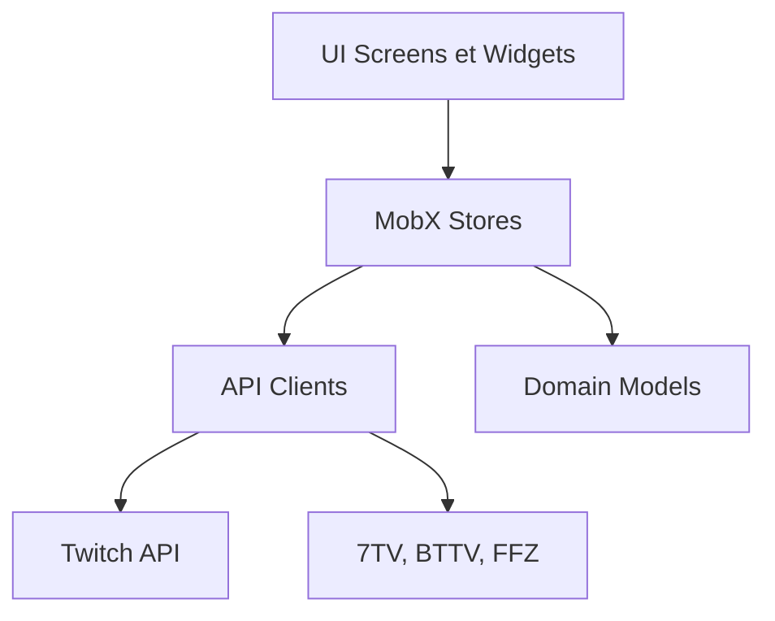

# tommyxchow/frosty

> Mobile Twitch client in Flutter that displays 7TV, BTTV and FFZ emotes, for viewers.

## The problem
The official Twitch app does not display third-party emotes: only their names appear, which makes the chat unreadable.

## What it actually does
Flutter application for Android and iOS (a web version exists in the repository). Browses followed or popular streams, plays live streams with chat, autocompletes emotes and mentions, and offers themes, room mode, picture-in-picture and a sleep timer. Screens go through MobX stores that call API clients (Twitch, 7TV, BTTV, FFZ).

## How it is wired


## Trying it
```bash
cp .env.example .env
flutter pub get
dart run scripts/get_twitch_token.dart
```

## Cost and gotchas
Free. To develop, you need a Twitch developer account (Client ID and Secret) and Flutter. AGPL-3.0 license: copyleft clauses if you redistribute.

## What it is not
Not a data tool: a Twitch viewing client.

## Alternatives
No alternative named in the README.

## For you
Ignore: a consumer application unrelated to data or AI, under the AGPL license.
