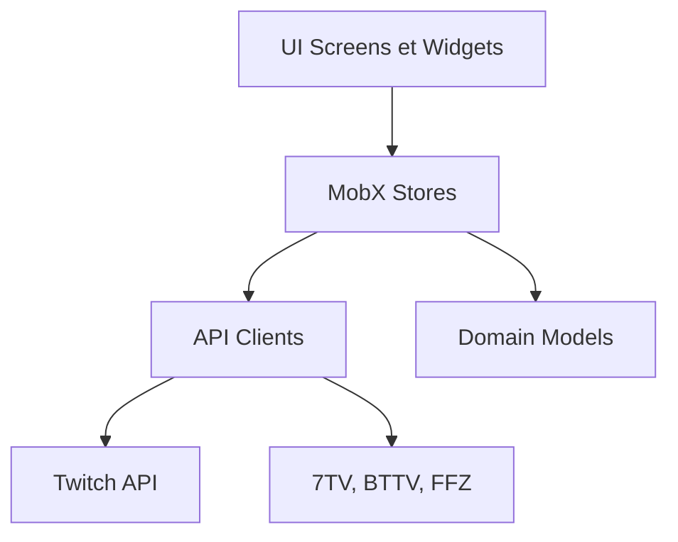

# tommyxchow/frosty

> Client Twitch mobile en Flutter qui affiche les emotes 7TV, BTTV et FFZ, pour spectateurs.

## Le problème
L'application officielle Twitch n'affiche pas les emotes tierces : seuls leurs noms apparaissent, ce qui rend le chat illisible.

## Ce que ça fait vraiment
Application Flutter pour Android et iOS (une version web existe dans le dépôt). Parcourt les streams suivis ou populaires, lit les lives avec chat, complète emotes et mentions, propose thèmes, mode salle, picture-in-picture, minuteur de sommeil. Les écrans passent par des stores MobX qui appellent des clients d'API (Twitch, 7TV, BTTV, FFZ).

## Comment c'est branché


## Essayer
```bash
cp .env.example .env
flutter pub get
dart run scripts/get_twitch_token.dart
```

## Coût et pièges
Gratuit. Pour développer, il faut un compte développeur Twitch (Client ID et Secret) et Flutter. Licence AGPL-3.0 : clauses copyleft si tu redistribues.

## Ce que ce n'est pas
Pas un outil de données : un client de visionnage Twitch.

## Alternatives
Aucune alternative nommée dans le README.

## Pour toi
À ignorer : application grand public sans rapport avec la data ou l'IA, sous licence AGPL.

