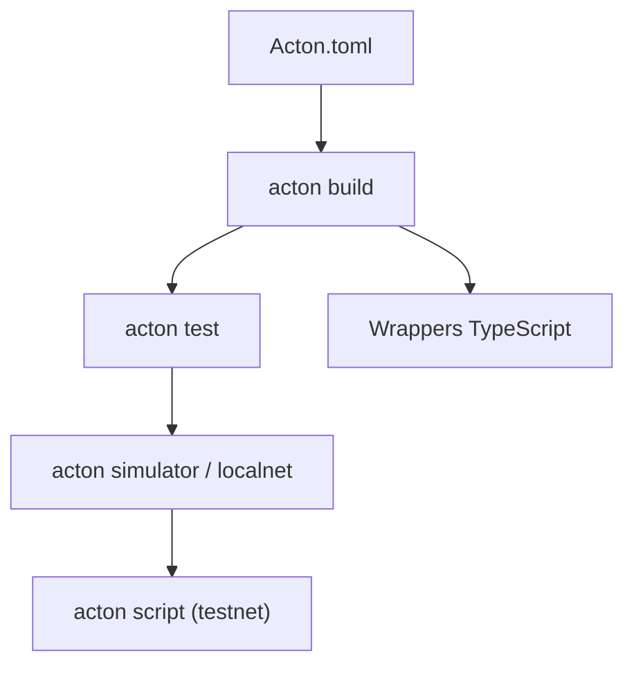

# ton-blockchain/acton

> End-to-end platform for developing, testing and deploying dApps on the TON blockchain.

## The problem
A TON project assembles compiler, tests, debugging, simulation and deployment from scattered tools.

## What it actually does
An `Acton.toml` file describes the project; the `acton` binary compiles Tolk contracts, tests them locally (fuzzing, coverage), measures gas, generates TypeScript wrappers, runs a simulator or a local network, then deploys to testnet. It also outputs JSON, SARIF and JUnit for CI.

## How it is wired


## Trying it
```bash
curl -LsSf https://github.com/ton-blockchain/acton/releases/latest/download/acton-installer.sh | sh
acton new first_counter --template counter
acton build
acton test
```

## Cost and gotchas
Free; a testnet wallet is funded with `acton wallet airdrop`. Binaries provided for macOS and Linux only. Docker possible.

## What it is not
Not a general-purpose tool: it only serves the TON ecosystem and the Tolk language.

## Alternatives
No alternative named in the README.

## For you
Ignore: TON blockchain toolchain, useful to contract developers, not to a data/AI/MLOps profile.
