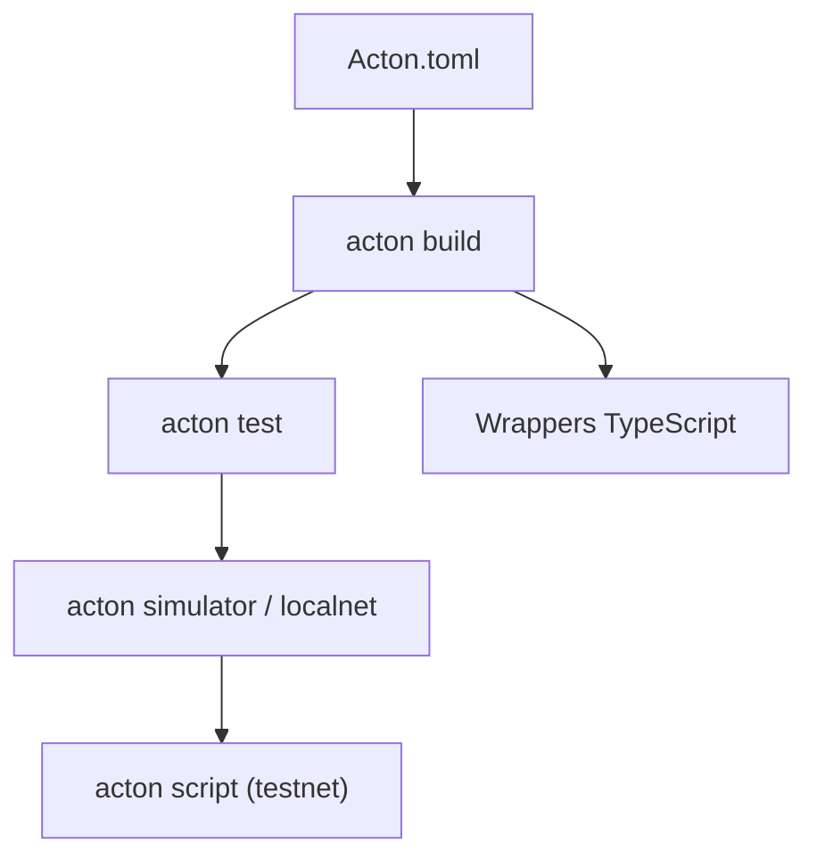

# ton-blockchain/acton

> Plateforme de bout en bout pour développer, tester et déployer des dApps sur la blockchain TON.

## Le problème
Un projet TON assemble compilateur, tests, débogage, simulation et déploiement avec des outils dispersés.

## Ce que ça fait vraiment
Un fichier `Acton.toml` décrit le projet ; le binaire `acton` compile les contrats Tolk, les teste localement (fuzzing, couverture), mesure le gaz, génère des wrappers TypeScript, lance un simulateur ou un réseau local, puis déploie sur testnet. Il sort aussi du JSON, SARIF et JUnit pour la CI.

## Comment c'est branché


## Essayer
```bash
curl -LsSf https://github.com/ton-blockchain/acton/releases/latest/download/acton-installer.sh | sh
acton new first_counter --template counter
acton build
acton test
```

## Coût et pièges
Gratuit ; un portefeuille testnet se finance par `acton wallet airdrop`. Binaires fournis pour macOS et Linux uniquement. Docker possible.

## Ce que ce n'est pas
Pas un outil généraliste : il ne sert qu'à l'écosystème TON et au langage Tolk.

## Alternatives
Aucune alternative nommée dans le README.

## Pour toi
À ignorer : toolchain blockchain TON, utile aux développeurs de contrats, pas à un profil data/IA/MLOps.

