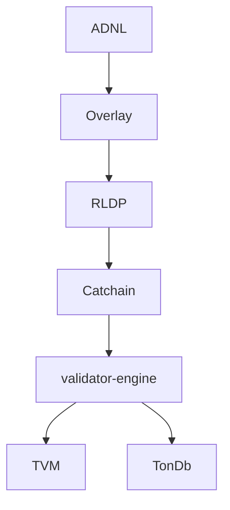

# ton-blockchain/ton

> Reference monorepo of the TON blockchain: node, validator, clients and FunC compiler.

## The problem
Running a node or developing on TON requires a coherent set of tools: network, consensus, virtual machine, compilers.

## What it actually does
The repository contains the node and validator, the lite-client, the tonlib library, the FunC compiler (tolk) and the Fift assembler, the TVM virtual machine and a storage daemon. According to the code, the network stacks ADNL, DHT, overlay and RLDP, consensus goes through Catchain, and state is written to a RocksDB database.

## How it is wired


## Trying it
```bash
sudo apt-get update
sudo apt-get install -y build-essential git cmake ninja-build
cp assembly/native/build-ubuntu-shared.sh .
chmod +x build-ubuntu-shared.sh
./build-ubuntu-shared.sh
```

## Cost and gotchas
Free, but building requires LLVM 21 (`llvm.sh` script) and a lot of time. Windows requires Visual Studio 2022. A license is present but not identified by GitHub: check before any use.

## What it is not
Not a wallet nor an application: these are the low-level building blocks of the protocol. The announced throughputs (millions of transactions per second) are a README goal, not measured here.

## Alternatives
No alternative named in the README.

## For you
Ignore: a blockchain stack unrelated to data or AI, and the license needs clarifying.
