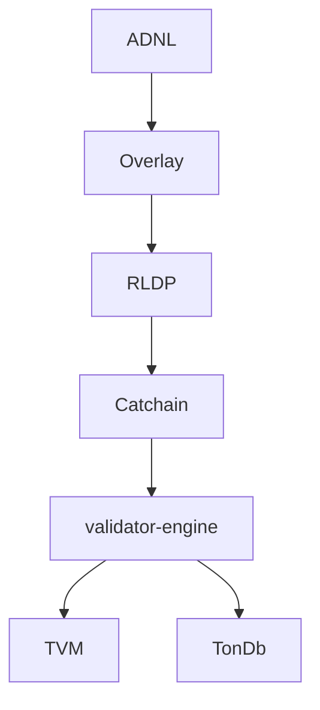

# ton-blockchain/ton

> Monodépôt de référence de la blockchain TON : nœud, validateur, clients et compilateur FunC.

## Le problème
Faire tourner un nœud ou développer sur TON demande un ensemble d'outils cohérents : réseau, consensus, machine virtuelle, compilateurs.

## Ce que ça fait vraiment
Le dépôt contient le nœud et validateur, le lite-client, la bibliothèque tonlib, le compilateur FunC (tolk) et l'assembleur Fift, la machine virtuelle TVM et un démon de stockage. D'après le code, le réseau empile ADNL, DHT, overlay et RLDP, le consensus passe par Catchain, et l'état est écrit dans une base RocksDB.

## Comment c'est branché


## Essayer
```bash
sudo apt-get update
sudo apt-get install -y build-essential git cmake ninja-build
cp assembly/native/build-ubuntu-shared.sh .
chmod +x build-ubuntu-shared.sh
./build-ubuntu-shared.sh
```

## Coût et pièges
Gratuit, mais la compilation demande LLVM 21 (script `llvm.sh`) et beaucoup de temps. Windows demande Visual Studio 2022. La licence est présente mais non identifiée par GitHub : à vérifier avant tout usage.

## Ce que ce n'est pas
Ce n'est pas un portefeuille ni une application : ce sont les briques de bas niveau du protocole. Les débits annoncés (millions de transactions par seconde) sont un objectif du README, non mesuré ici.

## Alternatives
Aucune alternative nommée dans le README.

## Pour toi
À ignorer : stack blockchain sans lien avec la data ou l'IA, et licence à clarifier.

