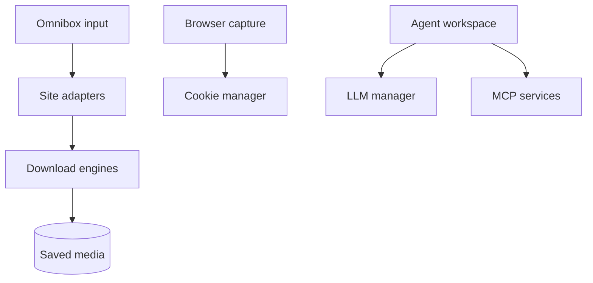

# tonhowtf/omniget

> Desktop application to download videos, audio and torrents, with an MCP server and AI agents.

## The problem
A different site for each platform, yt-dlp options you forget, and no history of downloads.

## What it actually does
Paste a link: OmniGet installs and updates yt-dlp and FFmpeg, downloads from YouTube, Instagram, TikTok, X, Reddit, torrents and direct files, with a resumable queue. A local MCP server lets Claude Code, Cursor or Codex start downloads. A browser extension passes on your cookies. An agents section runs Claude Code, Codex and Gemini CLI in one window, with permissions and cancellation.

## How it is wired


## Trying it
```bash
winget install -e --id tonhowtf.OmniGet
brew install --cask tonhowtf/tap/omniget
claude mcp add --transport http --scope project omniget <adresse> --header 'Authorization: Bearer ${OMNIGET_MCP_TOKEN}'
```

## Cost and gotchas
Free, no account. Unsigned binaries: a Windows and macOS warning to bypass on first launch. The MCP server is disabled by default and only listens on 127.0.0.1.

## What it is not
Does not bypass DRM or paid access; not a download solution for content you have no rights to. The "Tools" section is being rebuilt.

## Alternatives
yt-dlp alone, the engine OmniGet is built on.

## For you
Worth watching: the MCP angle for driving downloads from an agent is new, but the project is young and maintained by one person.
