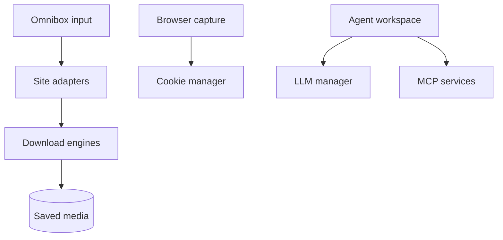

# tonhowtf/omniget

> Application de bureau pour télécharger vidéos, audio et torrents, avec serveur MCP et agents IA.

## Le problème
Un site différent par plateforme, des options yt-dlp qu'on oublie, et aucun historique de connexions.

## Ce que ça fait vraiment
Colle un lien : OmniGet installe et met à jour yt-dlp et FFmpeg, télécharge depuis YouTube, Instagram, TikTok, X, Reddit, torrents et fichiers directs, avec file d'attente reprenable. Un serveur MCP local laisse Claude Code, Cursor ou Codex lancer des téléchargements. Une extension navigateur transmet tes cookies. Une section agents fait tourner Claude Code, Codex et Gemini CLI dans une fenêtre, avec permissions et annulation.

## Comment c'est branché


## Essayer
```bash
winget install -e --id tonhowtf.OmniGet
brew install --cask tonhowtf/tap/omniget
claude mcp add --transport http --scope project omniget <adresse> --header 'Authorization: Bearer ${OMNIGET_MCP_TOKEN}'
```

## Coût et pièges
Gratuit, sans compte. Binaires non signés : avertissement Windows et macOS à contourner au premier lancement. Le serveur MCP est désactivé par défaut et n'écoute que sur 127.0.0.1.

## Ce que ce n'est pas
Ne contourne ni DRM ni accès payants ; pas une solution de téléchargement pour du contenu sans droits. La section « Tools » est en reconstruction.

## Alternatives
yt-dlp seul, moteur sur lequel OmniGet repose.

## Pour toi
À surveiller : l'angle MCP pour piloter des téléchargements par un agent est neuf, mais le projet est jeune et tenu par une personne.

