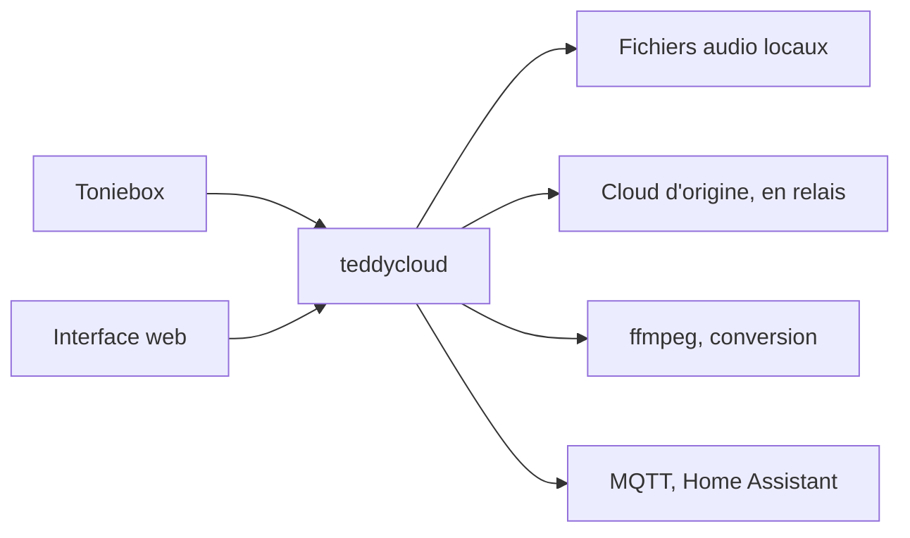

# toniebox-reverse-engineering/teddycloud

> Alternative local server for the Toniebox, hosting your own audio content, for home tinkerers.

## The problem
The Toniebox depends on the manufacturer's cloud: you control neither the data sent nor the audio content available.

## What it actually does
Replaces the Toniebox cloud with a server on your NAS. It serves audio, caches or relays the original content, converts files or streams (ffmpeg) to the tonie format. It sets the box's volume, LED and sounds, and offers a web interface, an MQTT client and a Home Assistant integration.

## How it is wired
Simplified diagram based on the sheet, no diagram provided.



## Trying it
```bash
# Images publiées sur ghcr.io (tags : latest, nightly-develop, rc)
docker pull ghcr.io/toniebox-reverse-engineering/teddycloud:latest
# Exemple Traefik fourni : docker/docker-compose.traefik.example.yaml
```
The full getting-started guide is on the project's website, not detailed in the README.

## Cost and gotchas
Free, but you need a Toniebox, a local server and a certificate extracted from the firmware. Do not expose publicly: authentication only protects the web interface, not the direct APIs.

## What it is not
Not a data or AI tool. Toniebox 2 support is only planned. Actual setup goes through a guide external to the README.

## Alternatives
No alternative named in the README.

## For you
Ignore: it is a home automation project for audio toys, unrelated to data, AI or MLOps work.
