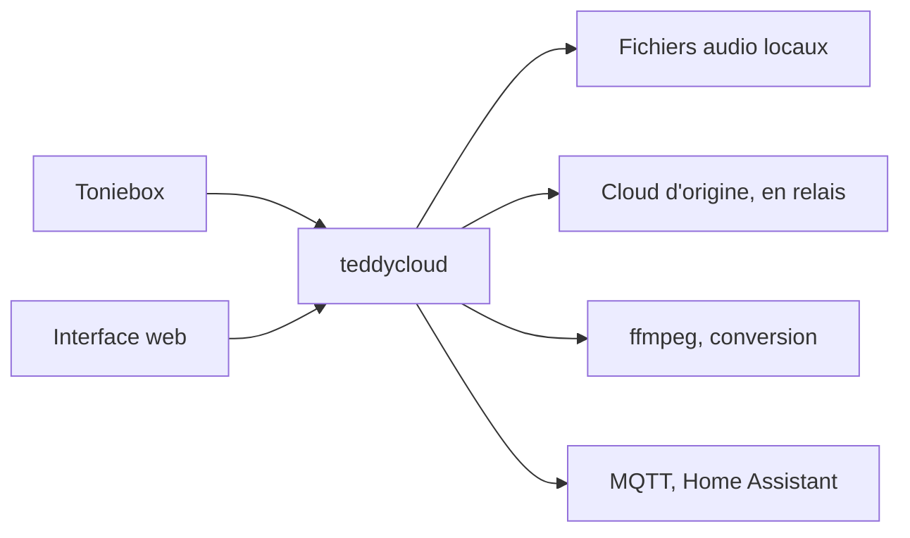

# toniebox-reverse-engineering/teddycloud

> Serveur local alternatif pour Toniebox, qui héberge tes propres contenus audio, pour les bricoleurs de la maison.

## Le problème
La Toniebox dépend du cloud du fabricant : tu ne contrôles ni les données envoyées ni les contenus audio disponibles.

## Ce que ça fait vraiment
Remplace le cloud de la Toniebox par un serveur sur ton NAS. Il sert l'audio, met en cache ou relaie le contenu original, convertit des fichiers ou flux (ffmpeg) au format tonie. Il règle volume, LED et sons de la boîte, et offre une interface web, un client MQTT et une intégration Home Assistant.

## Comment c'est branché
Schéma simplifié d'après la fiche, sans diagramme fourni.



## Essayer
```bash
# Images publiées sur ghcr.io (tags : latest, nightly-develop, rc)
docker pull ghcr.io/toniebox-reverse-engineering/teddycloud:latest
# Exemple Traefik fourni : docker/docker-compose.traefik.example.yaml
```
Le guide de démarrage complet est sur le site du projet, non détaillé dans le README.

## Coût et pièges
Gratuit, mais il faut une Toniebox, un serveur local et un certificat à extraire du firmware. Ne pas exposer en public : l'authentification ne protège que l'interface web, pas les API directes.

## Ce que ce n'est pas
Pas un outil data ou IA. Le support de la Toniebox 2 est seulement prévu. La mise en route réelle passe par un guide externe au README.

## Alternatives
Aucune alternative nommée dans le README.

## Pour toi
À ignorer : c'est un projet domotique pour jouets audio, sans lien avec un travail data, IA ou MLOps.

