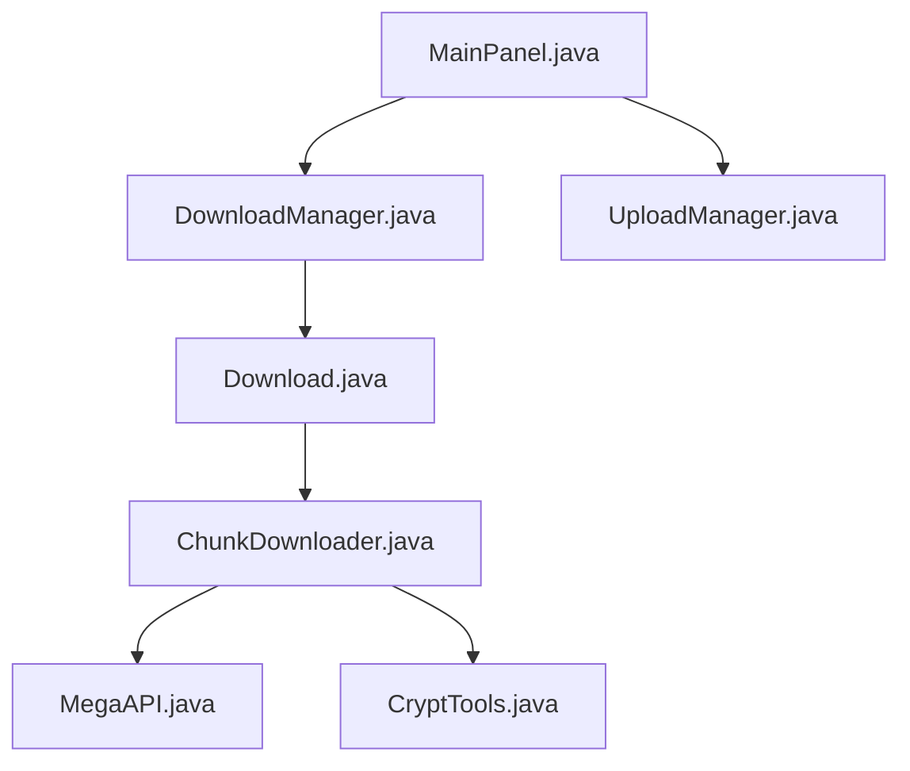

# tonikelope/megabasterd

> Java Swing application for downloading and uploading MEGA files, with an almost empty README.

## The problem
MEGA's web client is limited for handling large downloads in chunks.

## What it actually does
The README describes almost nothing. Judging from the code, MainPanel drives DownloadManager and UploadManager; each Download splits the file into chunks handled by ChunkDownloader, which calls MegaAPI, decrypts with CryptTools and can go through a proxy.

## How it is wired

## Trying it
No command documented: the README only offers to download the latest release.

## Cost and gotchas
Free. Java 8 or higher required (outside the standard prerequisites list). You must provide your own MEGA account and links. GPL-3.0.

## What it is not
Undocumented: nothing on limits, quotas or proxies in the README.

## Alternatives
No alternative named in the README.

## For you
Ignore: insufficient material and a consumer download tool, unrelated to data / AI / MLOps work.
