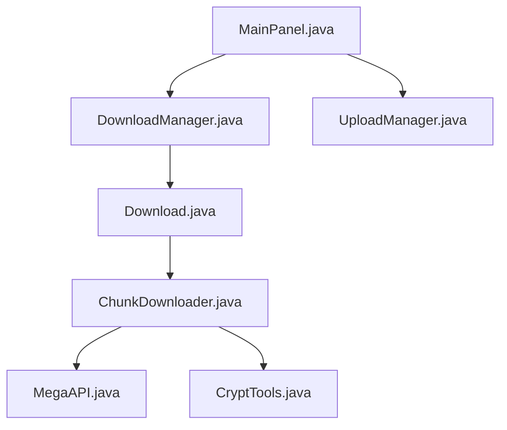

# tonikelope/megabasterd

> Application Java Swing de téléchargement et d'envoi de fichiers MEGA, README quasi vide.

## Le problème
Le client web de MEGA est limité pour gérer des téléchargements volumineux par morceaux.

## Ce que ça fait vraiment
Le README ne décrit presque rien. D'après le code, MainPanel pilote DownloadManager et UploadManager ; chaque Download découpe le fichier en morceaux traités par ChunkDownloader, qui appelle MegaAPI, déchiffre avec CryptTools et peut passer par un proxy.

## Comment c'est branché

## Essayer
Aucune commande documentée : le README propose seulement le téléchargement de la dernière version.

## Coût et pièges
Gratuit. Java 8 ou plus nécessaire (hors liste de prérequis standard). Compte MEGA et liens à fournir toi-même. GPL-3.0.

## Ce que ce n'est pas
Pas documenté : rien sur les limites, quotas ou proxies dans le README.

## Alternatives
Aucune alternative nommée dans le README.

## Pour toi
Ignorer : matière insuffisante et outil de téléchargement grand public, sans lien avec un travail data / IA / MLOps.

