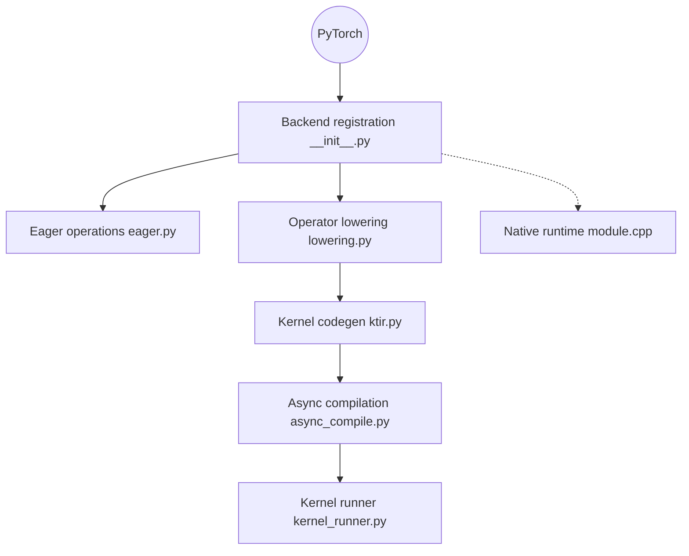

# torch-spyre/torch-spyre

> PyTorch backend that exposes the IBM Spyre accelerator as a `spyre` device, for those who own this hardware.

## The problem
A new accelerator is usable from PyTorch only with a layer that registers the device, routes operators and compiles kernels.

## What it actually does
Registers the `spyre` device via PyTorch's PrivateUse1 mechanism. Eager operations go through C++ implementations, with CPU fallback for unsupported operations. The compiled path goes through Spyre-specific Inductor transformations, kernel generation, then their execution. Profiling is under development.

## How it is wired


## Trying it
```bash
python3 docs/source/user_guide/examples/tensor_allocate.py
python3 docs/source/user_guide/examples/softmax.py
make tests
```

## Cost and gotchas
Building requires a development IBM Spyre software stack; the internal instructions are reserved for IBM employees. Without the hardware, there is nothing to run.

## What it is not
It is not a generic backend: it only works for Spyre hardware. According to the README, it is not a project installable with a single `pip install`.

## Alternatives
- open_registration_extension: an example of an out-of-tree PrivateUse1 backend that this project draws on.

## For you
Ignore: unless you have access to an IBM Spyre machine and its internal stack, you can neither build nor run it.
