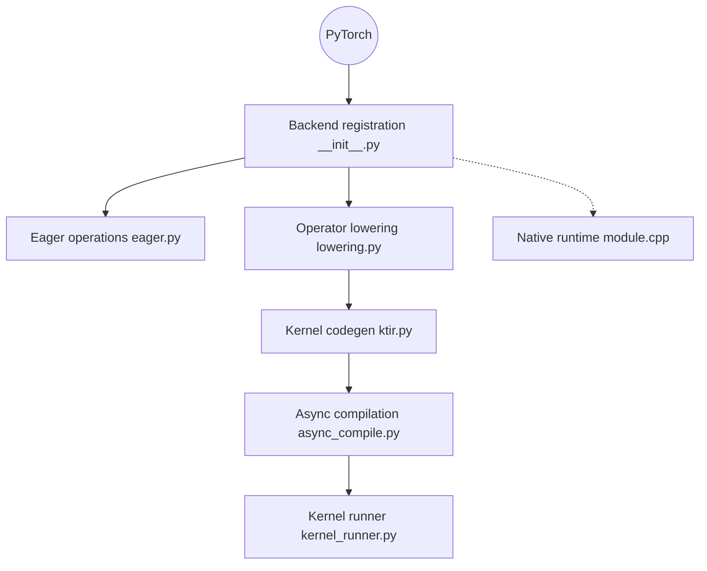

# torch-spyre/torch-spyre

> Backend PyTorch qui expose l'accélérateur IBM Spyre comme un périphérique `spyre`, pour qui possède ce matériel.

## Le problème
Un nouvel accélérateur n'est utilisable depuis PyTorch qu'avec une couche qui enregistre le périphérique, route les opérateurs et compile les noyaux.

## Ce que ça fait vraiment
Enregistre le device `spyre` via le mécanisme PrivateUse1 de PyTorch. Les opérations eager passent par des implémentations C++, avec repli CPU pour les opérations non couvertes. Le chemin compilé passe par des transformations Inductor spécifiques, une génération de noyaux, puis leur exécution. Le profilage est en cours de développement.

## Comment c'est branché


## Essayer
```bash
python3 docs/source/user_guide/examples/tensor_allocate.py
python3 docs/source/user_guide/examples/softmax.py
make tests
```

## Coût et pièges
La construction exige une pile logicielle IBM Spyre de développement ; les instructions internes sont réservées aux employés IBM. Sans le matériel, rien à faire tourner.

## Ce que ce n'est pas
Ce n'est pas un backend générique : il ne fonctionne que pour le matériel Spyre. Ce n'est pas un projet installable en un `pip install` d'après le README.

## Alternatives
- open_registration_extension : exemple de backend hors arbre PrivateUse1 dont ce projet s'inspire.

## Pour toi
À ignorer : sauf accès à une machine IBM Spyre et à sa pile interne, tu ne peux ni le construire ni l'exécuter.

