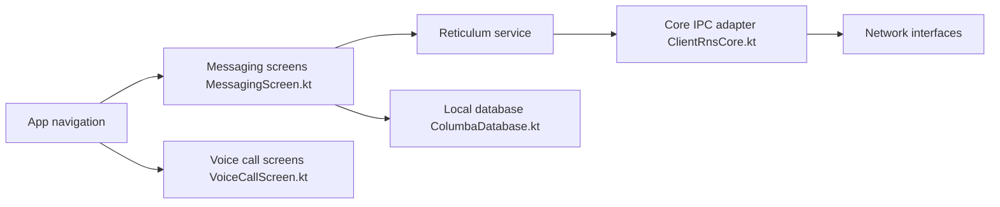

# torlando-tech/columba

> Android app for messaging and voice calls over the Reticulum mesh network, with no central server.

## The problem
Communicating without internet, cell towers or a central server, with encrypted exchanges and no account.

## What it actually does
LXMF messages and LXST voice calls over Bluetooth LE, Wi-Fi, LoRa radio (RNode) or TCP to a Reticulum server. Location sharing with offline maps (MBTiles), NomadNet browser, traffic relaying, multiple exportable identities and sharing by QR code. Local storage.

## How it is wired

## Trying it
No documented command: download the APK from the Releases and install it on Android (APK verification in SECURITY.md).

## Cost and gotchas
Free, no account. LoRa requires RNode hardware. The network only has value if there are peers near you.

## What it is not
Not a mainstream messenger with a directory: it relies on Reticulum. Not a tool for AI or data.

## Alternatives
Sideband, cited as another Reticulum client whose identities can be imported.

## For you
Ignore: mesh messaging for offline-network enthusiasts, with no direct use for a data/AI/MLOps profile.
