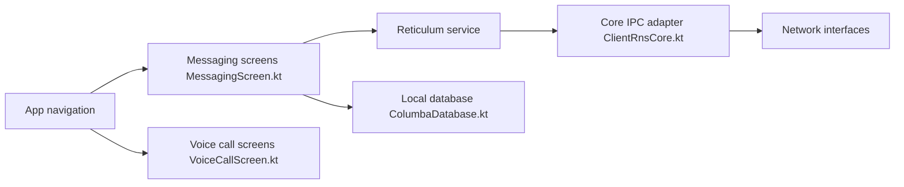

# torlando-tech/columba

> Appli Android de messagerie et d'appels vocaux sur le réseau maillé Reticulum, sans serveur central.

## Le problème
Communiquer sans internet, antennes ni serveur central, avec des échanges chiffrés sans compte.

## Ce que ça fait vraiment
Messages LXMF et appels vocaux LXST via Bluetooth LE, Wifi, radio LoRa (RNode) ou TCP vers un serveur Reticulum. Partage de position avec cartes hors ligne (MBTiles), navigateur NomadNet, relais de trafic, identités multiples exportables et partage par QR code. Stockage local.

## Comment c'est branché

## Essayer
Aucune commande documentée : télécharger l'APK depuis les Releases et l'installer sur Android (vérification des APK dans SECURITY.md).

## Coût et pièges
Gratuit, sans compte. La LoRa demande du matériel RNode. Le réseau n'a de valeur que s'il y a des pairs près de toi.

## Ce que ce n'est pas
Pas un messager grand public avec annuaire : il s'appuie sur Reticulum. Pas un outil pour l'IA ou la donnée.

## Alternatives
Sideband, cité comme autre client Reticulum dont on peut importer les identités.

## Pour toi
Ignorer : messagerie maillée pour passionnés de réseaux hors ligne, sans usage direct pour un profil data/IA/MLOps.

