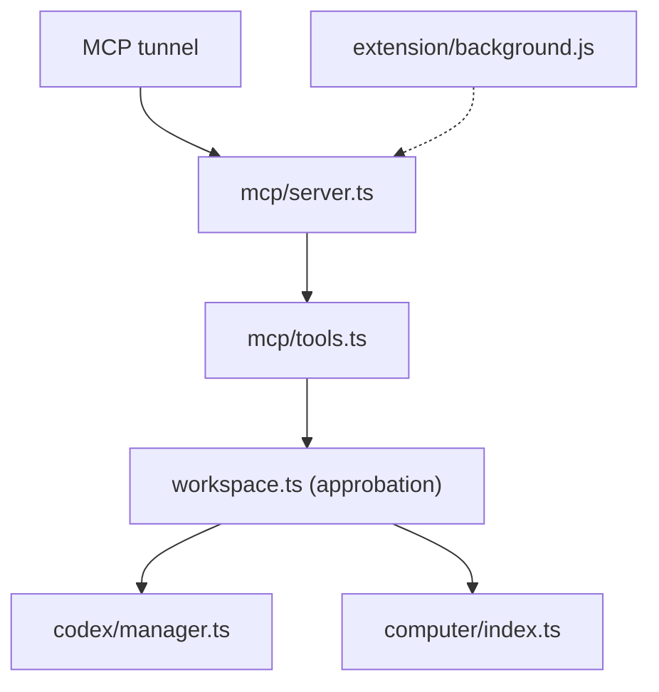

# totec448-spec/chat-on-steroids

> Desktop application that gives ChatGPT local tools: files, terminal, desktop and parallel agents.

## The problem
A ChatGPT chat does not see your local project, does not run tests and cannot sustain a long task.

## What it actually does
An Electron app exposes a local MCP server to ChatGPT (via a tunnel), with file reading and editing, command execution, desktop control and worker agents. A browser extension observes and automates the ChatGPT interface. It adds ntfy or Telegram notifications, manual steps for the human and allowed folders.

## How it is wired

## Trying it
No documented command: install the application, open Settings > Setup and follow the seven steps (browser extension, folder, tunnel, adding the MCP in ChatGPT).

## Cost and gotchas
Requires a ChatGPT account able to create custom MCP applications, a tunnel and a restricted OpenAI API key. Unsigned beta version (Windows, macOS). Commands run with your user rights.

## What it is not
Not a public ChatGPT API: the extension automates the web interface. The README states that this does not amount to permission under OpenAI's terms.

## Alternatives
No alternative named in the README.

## For you
Ignore: it depends on automating the ChatGPT interface and risks causing a terms-of-use problem.
