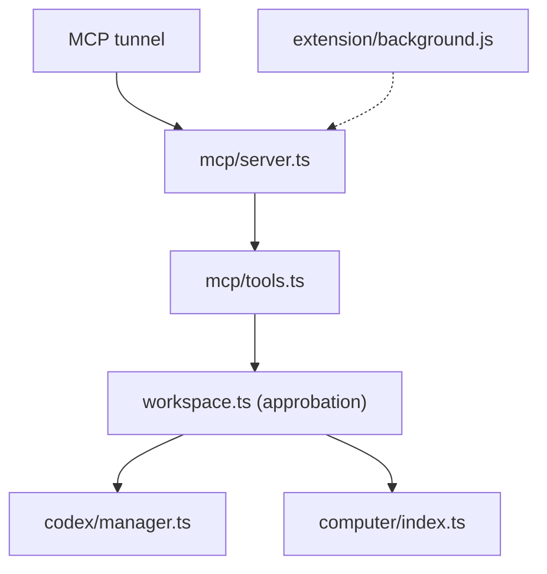

# totec448-spec/chat-on-steroids

> Application de bureau qui donne à ChatGPT des outils locaux : fichiers, terminal, bureau et agents parallèles.

## Le problème
Un chat ChatGPT ne voit pas ton projet local, ne lance pas de tests et ne tient pas une longue tâche.

## Ce que ça fait vraiment
Une appli Electron expose un serveur MCP local à ChatGPT (via un tunnel), avec lecture et édition de fichiers, exécution de commandes, contrôle du bureau et agents ouvriers. Une extension de navigateur observe et automatise l'interface ChatGPT. Ajoute des notifications ntfy ou Telegram, des étapes manuelles pour l'humain et des dossiers autorisés.

## Comment c'est branché

## Essayer
Aucune commande documentée : installer l'application, ouvrir Réglages > Setup et suivre les sept étapes (extension navigateur, dossier, tunnel, ajout du MCP dans ChatGPT).

## Coût et pièges
Nécessite un compte ChatGPT pouvant créer des applications MCP personnalisées, un tunnel et une clé API restreinte OpenAI. Version bêta non signée (Windows, macOS). Les commandes s'exécutent avec tes droits d'utilisateur.

## Ce que ce n'est pas
Pas une API publique de ChatGPT : l'extension automatise l'interface web. Le README précise que cela ne vaut pas permission au regard des conditions d'OpenAI.

## Alternatives
Aucune alternative nommée dans le README.

## Pour toi
À ignorer : dépend de l'automatisation de l'interface ChatGPT et risque de poser un problème de conditions d'usage.

