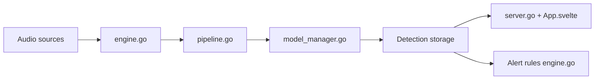

# tphakala/birdnet-go

> Self-hosted real-time analyzer of bird, wildlife and bat sounds, for enthusiasts and researchers.

## The problem
Identifying species continuously from an audio stream requires a chain of capture, models and alerts.

## What it actually does
Captures from a sound card or RTSP streams, classifies with BirdNET v2.4, Perch v2, BattyBirdNET and a geolocation model, with consensus between models. Svelte interface with live spectrogram, alerts (Discord, MQTT with Home Assistant, webhooks...), SQLite or MySQL, OIDC, backups. A single binary, a Raspberry Pi 4 is enough.

## How it is wired


## Trying it
```bash
curl -fsSL https://github.com/tphakala/birdnet-go/raw/main/install.sh -o install.sh
bash ./install.sh
```

## Cost and gotchas
Free, local. Sentry telemetry is strictly optional. The eBird taxonomy is under non-commercial terms. A license is present but not identified by GitHub: to be checked. 188 open issues.

## What it is not
Not a general training tool (a custom TFLite classifier is possible). The bat models require an ultrasonic microphone.

## Alternatives
BirdNET-Analyzer (upstream); birda for offline file analysis, named in the README.

## For you
Adopt for a bioacoustics use case or as an example of real-time edge inference; check the license before any redistribution.
