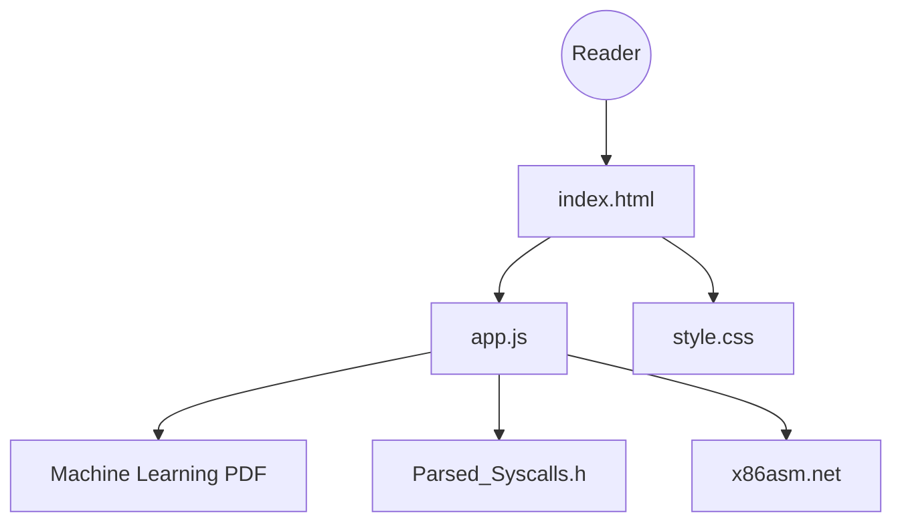

# tpn/pdfs

> Personal collection of about 1,900 technical PDFs, with a search site, for readers curious about low-level topics.

## The problem
Finding technical articles, manuals and slides scattered around, with no index or search.

## What it actually does
Document archive (machine learning book, 100G network slides, Windows kernel articles, syscall and x86 assembly references). A small static site (index.html, app.js, style.css) lets you search, filter and download.

## How it is wired

## Trying it
No documented command: open tpn.github.io/pdfs, or https://github.dev/tpn/pdfs to see the full list (GitHub truncates the list at 1,000 entries).

## Cost and gotchas
Free. No license declared; rights remain with each author, and the author invites reporting any questionable PDF. Content focused on systems and networking.

## What it is not
Not a library curated by AI theme: it is a personal catch-all. The architecture notes that the README is empty and that the site was not examined in detail.

## Alternatives
No alternative named in the README.

## For you
Ignore: little connection to data or MLOps work, no license, and a corpus oriented toward kernel and networking.
