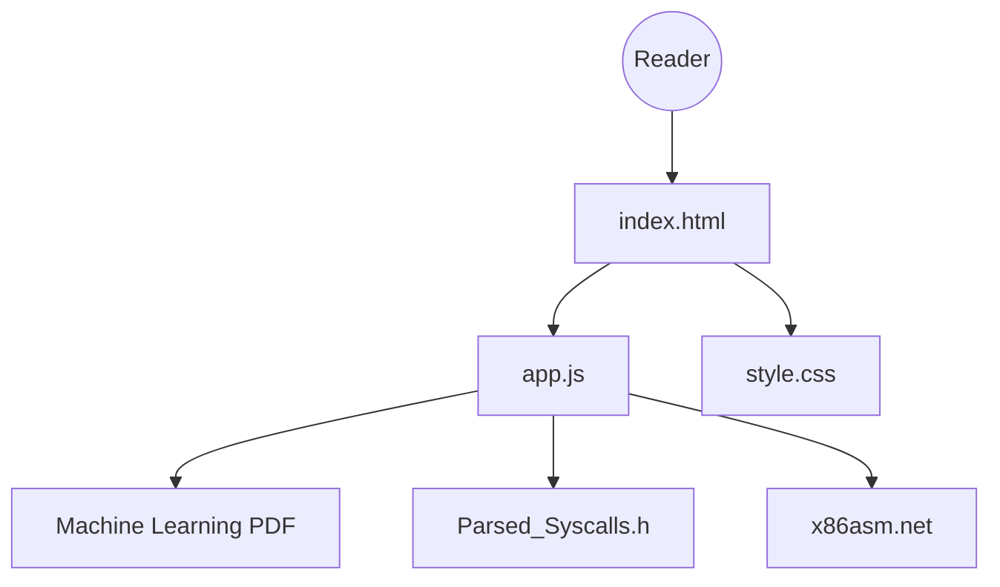

# tpn/pdfs

> Collection personnelle d'environ 1 900 PDF techniques, avec un site de recherche, pour lecteurs curieux de bas niveau.

## Le problème
Retrouver des articles, manuels et slides techniques dispersés, sans index ni recherche.

## Ce que ça fait vraiment
Archive de documents (livre d'apprentissage automatique, slides réseau 100G, articles noyau Windows, références syscalls et assembleur x86). Un petit site statique (index.html, app.js, style.css) permet de chercher, filtrer et télécharger.

## Comment c'est branché

## Essayer
Aucune commande documentée : ouvrir tpn.github.io/pdfs, ou https://github.dev/tpn/pdfs pour voir la liste complète (GitHub tronque la liste à 1 000 entrées).

## Coût et pièges
Gratuit. Aucune licence déclarée ; les droits restent à chaque auteur, et l'auteur invite à signaler un PDF litigieux. Contenu centré sur le système et le réseau.

## Ce que ce n'est pas
Pas une bibliothèque curée par thème d'IA : c'est un fourre-tout personnel. L'architecture note que le README est vide et que le site n'a pas été examiné en détail.

## Alternatives
Aucune alternative nommée dans le README.

## Pour toi
À ignorer : peu de lien avec un travail data ou MLOps, licence absente, et corpus orienté noyau et réseau.

