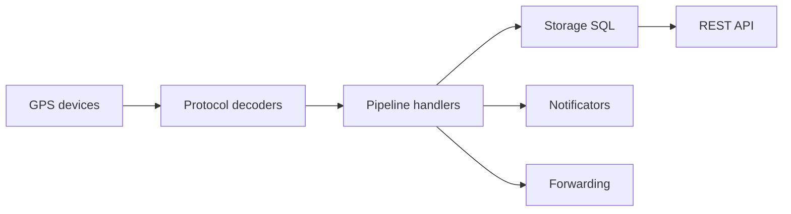

# traccar/traccar

> Java GPS tracking server handling over 200 tracker protocols, for fleets and individuals.

## The problem
Each GPS tracker brand speaks its own protocol; you need a single server that decodes and stores them.

## What it actually does
A Netty server that decodes frames (`protocol` package), passes them through a pipeline of handlers (attribute computation, geofencing, events), stores in SQL, exposes a REST API, sends notifications (mail, SMS) and forwards to Kafka, MQTT or AMQP. CSV/KML/GPX reports.

## How it is wired


## Trying it
```bash
curl -o compose.yaml https://raw.githubusercontent.com/traccar/traccar/master/docker/compose/traccar-mysql.yaml
docker compose up -d
```
Then available on port 8082.

## Cost and gotchas
Free when self-hosted; official managed hosting is paid (cited). Docker and a SQL database required. 403 open issues.

## What it is not
Not a general mapping app nor an analytics tool: the web interface is a separate repository.

## Alternatives
No alternative named in the README.

## For you
Ignore unless you have a streaming geolocation data project; otherwise outside your scope.
