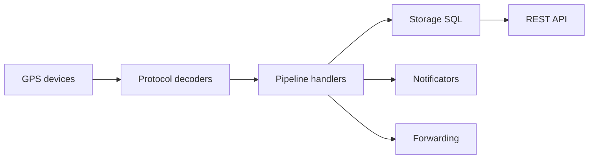

# traccar/traccar

> Serveur Java de suivi GPS gérant plus de 200 protocoles de balises, pour flottes et particuliers.

## Le problème
Chaque marque de traceur GPS parle son protocole ; il faut un serveur unique qui les décode et les stocke.

## Ce que ça fait vraiment
Serveur Netty qui décode les trames (package `protocol`), les passe dans un pipeline de handlers (calcul d'attributs, géorepérage, événements), stocke en SQL, expose une API REST, notifie (mail, SMS) et redirige vers Kafka, MQTT ou AMQP. Rapports CSV/KML/GPX.

## Comment c'est branché


## Essayer
```bash
curl -o compose.yaml https://raw.githubusercontent.com/traccar/traccar/master/docker/compose/traccar-mysql.yaml
docker compose up -d
```
Disponible ensuite sur le port 8082.

## Coût et pièges
Gratuit en auto-hébergement ; hébergement géré officiel payant (cité). Docker et une base SQL requis. 403 issues ouvertes.

## Ce que ce n'est pas
Pas une appli de cartographie générale ni un outil d'analytique : l'interface web est un dépôt séparé.

## Alternatives
Aucune alternative nommée dans le README.

## Pour toi
À ignorer sauf projet de données de géolocalisation en flux ; sinon hors de ton périmètre.

